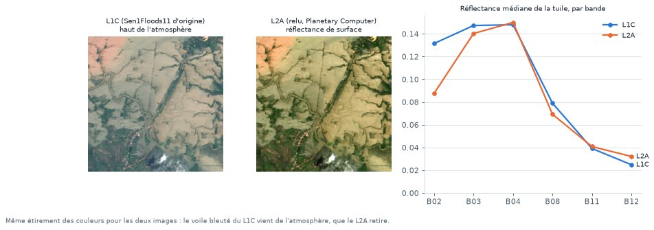
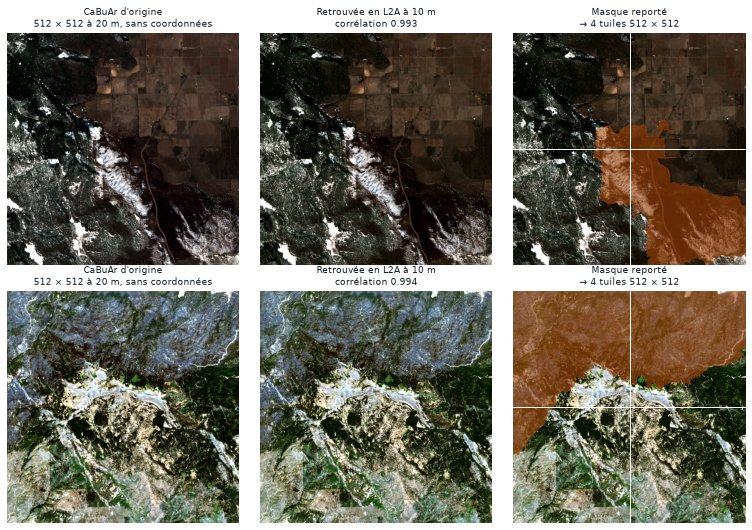

# Harmonisation : une seule source, un seul niveau

## Le problème

Les deux jeux annotés ne sont pas au même niveau de traitement :

| | Sen1Floods11 (inondations) | CaBuAr (incendies) |
|---|---|---|
| Niveau | **L1C** : lumière mesurée au sommet de l'atmosphère | **L2A** : réflectance de surface, atmosphère retirée |
| Résolution | 10 m | 20 m |
| Géoréférence | Oui | **Non** dans le fichier pré-découpé |

Mélangés tels quels, un modèle apprendrait un raccourci : « image voilée de L1C = inondation, image nette de L2A = incendie ». Il aurait de bons scores, mais pour une mauvaise raison, et échouerait sur une image d'évaluation d'un autre niveau.

## La solution

**Toutes les tuiles, de toutes les classes, sont relues depuis la même source**, aux mêmes lieux et aux mêmes dates (module `onelook.data.l2a`) :

| | Choix |
|---|---|
| Source | Microsoft Planetary Computer, collection `sentinel-2-l2a` (archive complète depuis 2015, accès gratuit sans compte) |
| Niveau | **L2A** (réflectance de surface), 12 bandes |
| Résolution | 10 m ; les bandes à 20 et 60 m sont rééchantillonnées (bilinéaire) |
| Valeurs | Réflectance × 10 000. Le décalage de +1 000 des scènes traitées depuis 2022 (baseline 04.00) est retiré |
| Tuile | 512 × 512 pixels, en GeoTIFF, avec la carte SCL (nuages, eau, neige) |
| Lecture | À distance (COG) : seuls les octets de la tuile sont lus, environ 2 à 3 s par tuile |

**Pourquoi L2A :** c'est le seul niveau disponible gratuitement, sans compte et sur toute l'archive. Il retire l'effet de l'atmosphère, donc les images de régions et de dates différentes se comparent mieux. Si l'évaluation se fait en L1C, la même méthode s'appliquera avec le Copernicus Data Space (compte gratuit requis).

<figure markdown="span">
  
  <figcaption>Une tuile Sen1Floods11 (Mékong) au même jour, avec le même étirement des couleurs. Le L1C d'origine est voilé de bleu : c'est la lumière diffusée par l'atmosphère. En L2A, le bleu (B02) passe de 0,13 à 0,09, et l'image se compare enfin aux tuiles CaBuAr.</figcaption>
</figure>

## Sen1Floods11 : même grille, même jour

Chaque tuile est relue sur la grille exacte de ses masques annotés (EPSG:4326, ~10 m), au jour d'acquisition donné par les métadonnées. Les masques sont réutilisés tels quels.

## CaBuAr : retrouver la position de chaque tuile

Le fichier CaBuAr pré-découpé (5,9 Go) renumérote ses tuiles et ne garde pas leurs coordonnées. Seule la scène d'origine est connue (métadonnées : 121 tuiles par scène, sur une grille 11 × 11).

La méthode (`onelook.data.build.CabuarScene`) :

1. La bande B08 de toute la scène est lue une fois, en basse résolution (320 m).
2. Pour chaque tuile CaBuAr, sa bande B08 est comparée à chaque position candidate de la grille ; la position la mieux **corrélée** est retenue.
3. La tuile est relue en L2A à 10 m à cette position. Une tuile CaBuAr de 10 × 10 km donne **4 tuiles de 512 × 512** ; le masque brûlé est agrandi en conséquence (plus proche voisin).
4. Une tuile dont la meilleure corrélation est sous 0,8 est rejetée (5 cas).

<figure markdown="span">
  
  <figcaption>À gauche, la tuile CaBuAr d'origine (20 m, sans coordonnées). Au centre, la même zone retrouvée et relue en L2A à 10 m. À droite, le masque brûlé reporté, découpé en 4 tuiles de 512 × 512.</figcaption>
</figure>

## Contrôles

| Contrôle | Résultat |
|---|---|
| Alignement Sen1Floods11 L1C / L2A relu (corrélation B08) | 0,985 à 0,996 |
| Alignement CaBuAr d'origine / relu (corrélation B08) | 0,92 à 0,997 |
| Médiane B02 (bleu) : Sen1Floods11 L1C → L2A, CaBuAr | 0,142 → **0,087**, CaBuAr 0,079 |
| Médiane B12 (SWIR) : Sen1Floods11 L2A, CaBuAr | 0,067 contre 0,227 |

Le bleu, très sensible à l'atmosphère, est maintenant au même niveau dans les deux sources : l'écart dû au traitement a disparu. **L'écart restant en SWIR vient des paysages** (zones tropicales humides contre Californie sèche). C'est un biais réel, que les [images normales](normals.md) sèches (Californie, Sahara, Sahel, Mongolie) compensent en partie.
