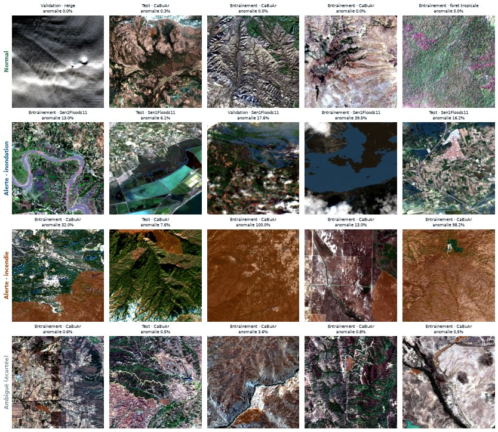
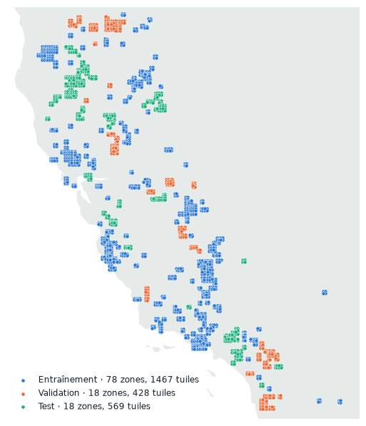

# Étiquettes et découpage

## De la vérité terrain à la décision attendue

Chaque tuile a un masque de vérité terrain : eau d'inondation (Sen1Floods11, annotée à la main, eau permanente retirée) ou zone brûlée (CaBuAr, d'après les périmètres CAL FIRE). La décision attendue se déduit de la **part de la tuile** couverte par l'anomalie (`configs/labels.yaml`, module `onelook.data.labels`) :

| Part de la tuile touchée | Décision attendue |
|---|---|
| ≥ 5 % d'eau d'inondation **visible** | Alerte · inondation |
| ≥ 5 % de surface brûlée | Alerte · incendie |
| < 0,5 % des deux | Normal |
| Entre les deux | Ambiguë : écartée de l'entraînement et de l'évaluation des alertes, analysée à part |

Trois choix à noter :

- **5 % de la tuile, c'est environ 1,3 km².** Assez pour justifier une alerte, sans compter les petites mares ou les brûlis agricoles.
- **La part est comptée sur la tuile entière, pas sur sa partie visible.** Une inondation cachée sous les nuages ne compte pas : le modèle ne doit pas alerter sur ce qu'il ne voit pas.
- **La zone ambiguë évite d'apprendre des frontières arbitraires.** Une tuile à 2 % d'eau n'est ni clairement normale, ni clairement en alerte.

La décision Inconnu n'est pas une classe apprise : elle viendra du score de confiance du modèle, calibré sur la validation, et sera testée sur un lot de phénomènes jamais vus.

<figure markdown="span">
  
  <figcaption>Cinq tuiles tirées au hasard pour chaque décision, avec la vérité terrain en surimpression (bleu : eau d'inondation, orange : brûlé). Le titre donne la partie, l'origine et la part d'anomalie.</figcaption>
</figure>

## Le découpage : jamais au hasard

Le sujet exige d'évaluer sur des **zones et des dates jamais vues**. Si deux tuiles voisines d'une même image vont l'une en entraînement et l'autre en test, le modèle les reconnaît sans rien comprendre : c'est une **fuite**, et les scores sont faux.

Le découpage se fait donc **par groupe** (`configs/splits.yaml`) : un groupe entier va dans une seule partie.

| Données | Groupe | Test | Validation | Entraînement |
|---|---|---|---|---|
| Inondations | Pays de l'événement | Bolivie, Espagne, Sri Lanka | Nigeria, Somalie | Ghana, Inde, Mékong, Pakistan, Paraguay, USA |
| Incendies | Zone spatiale (voir plus bas) | ~20 % des tuiles brûlées | ~15 % | ~65 % |
| Normales | Grande région | Asie du Sud, Australie, Himalaya, Californie du Sud | Europe du Nord, Afrique de l'Est, Afrique australe, Moyen-Orient | Toutes les autres |

Au total, 95 groupes vont en entraînement, 24 en validation et 25 en test.

## Les incendies : des zones, pas des plis

CaBuAr fournit 5 « plis » prêts à l'emploi. Le contrôle de fuite a montré qu'ils séparent des **scènes**, pas des **lieux** : la même zone de Californie, photographiée à plusieurs dates, se retrouvait dans plusieurs plis. Le découpage par pli laissait **1 805 paires** de tuiles de parties différentes à moins de 10 km, certaines au même endroit exact.

Le découpage retenu (module `onelook.data.splits`) :

1. Les tuiles CaBuAr reliées de proche en proche à moins de 10 km forment une **zone** (114 zones).
2. Chaque zone entière va dans une partie. Les zones les plus brûlées sont placées en premier, chacune dans la partie la plus en retard sur sa cible (65 / 15 / 20 % des tuiles brûlées).
3. Les images avant feu suivent leur zone, ainsi que toute normale du catalogue située à moins de 10 km.

<figure markdown="span">
  
  <figcaption>Les tuiles CaBuAr et les images avant feu en Californie. Chaque amas de même couleur est une zone, entièrement dans une seule partie.</figcaption>
</figure>

## Contrôle de fuite spatiale

`scripts/dataset_report.py` calcule la distance entre toutes les paires de tuiles de parties différentes.

| Découpage | Paires à moins de 10 km |
|---|---|
| Par pli CaBuAr (premier essai) | 1 805 |
| Par zone, sans les normales voisines | 24 (toutes avec le site `californie_collines`) |
| **Par zone, normales voisines rattachées (retenu)** | **0** |
