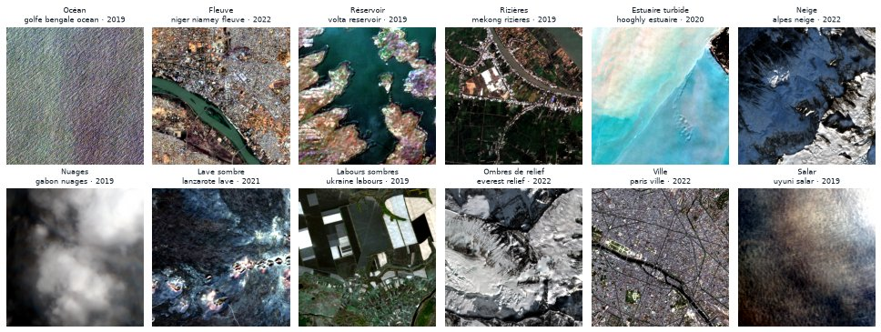

# Images normales et pièges

Un modèle d'alerte se juge autant à ses **fausses alertes** qu'à ses détections. Il doit donc voir beaucoup d'images où il ne se passe rien, y compris des paysages qui ressemblent à une anomalie.

## Quatre origines

| Origine | Tuiles | Comment |
|---|---|---|
| Quarts CaBuAr non brûlés | 1 412 | Les quarts d'une tuile CaBuAr où presque rien n'a brûlé |
| Images avant feu | 352 | Le même lieu qu'un feu, avant l'incendie : le contraste parfait |
| Catalogue de sites | 233 | 59 sites choisis à la main (`configs/normal_sites.yaml`), chacun sur 4 années (2019 à 2022) |
| Points au hasard | 185 | Tirés dans 15 grandes régions (`configs/normal_random.yaml`), graine fixe |
| Tuiles Sen1Floods11 sans inondation | 128 | Eau d'inondation absente ou sous 0,5 % de la tuile |

Pour chaque site, le passage retenu est le moins nuageux de la fenêtre (sous 10 % de nuages), ou volontairement le plus nuageux (plus de 50 %) pour la catégorie « nuages ».

## Les pièges

Les pièges sont normaux, mais trompeurs. Ils servent à apprendre au modèle à ne pas alerter pour rien, et à mesurer ses fausses alertes sur les cas difficiles.

<figure markdown="span">
  
  <figcaption>Douze pièges du catalogue, en couleurs naturelles. Aucun ne doit déclencher d'alerte.</figcaption>
</figure>

| Piège | Pour | Pourquoi il trompe |
|---|---|---|
| Océan, littoral, estuaire turbide | Inondation | Beaucoup d'eau, mais permanente ; l'estuaire est boueux comme une crue |
| Fleuve, lac, réservoir | Inondation | De l'eau permanente, dont le niveau varie (berges noyées) |
| Rizières | Inondation | Eau saisonnière normale, en parcelles |
| Neige, glace, nuages | Inondation | Très réfléchissants ; la neige est confondue avec l'eau par certains indices |
| Ombres de relief et de nuages | Inondation, incendie | Sombres comme l'eau ou le brûlé |
| Labours, sol nu sombre | Incendie | Peuvent ressembler à du sol brûlé |
| Lave, roches volcaniques | Incendie | Sombres dans le proche infrarouge |
| Villes (asphalte) | Incendie | Sombres, et SWIR élevé comme le brûlé |
| Salar | Inondation | Plat et brillant, parfois couvert d'une fine pellicule d'eau |

Les pièges sont répartis dans les **trois parties**, pour que le test mesure vraiment la résistance du modèle. Le détail des pièges d'eau est sur la page [Eau permanente](water.md).

## Vérifications

Chaque site du catalogue a été vérifié à l'œil sur une planche-contact. Constats :

- Trois sites ont été déplacés : le premier site « labours » tombait sur un réservoir, le site « rizières » sur une ville, et le site « océan » au-delà de la zone photographiée par Sentinel-2 (qui ne couvre la mer que jusqu'à ~20 km des côtes).
- **La carte SCL se trompe sur certains pièges** : elle classe le salar d'Uyuni en neige et une grande partie des laves de Lanzarote en eau (83 %). Ce sont exactement les confusions que le modèle devra éviter.
- Une tuile d'océan côtier montre une bande claire à bord net : un raccord entre deux scènes du même passage. Elle est gardée comme normale, car ce genre d'artefact peut apparaître en évaluation.
- Les points au hasard ne sont pas vérifiés un par un ; le contrôle d'[eau inattendue](water.md#controle-des-normales) repère ceux qui pourraient cacher une inondation.
