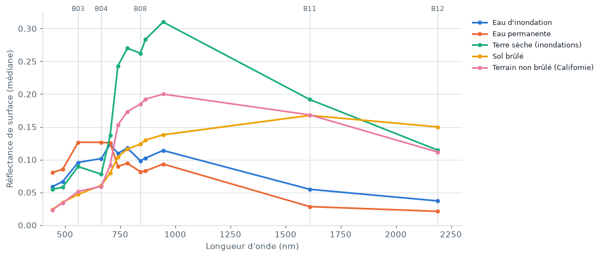
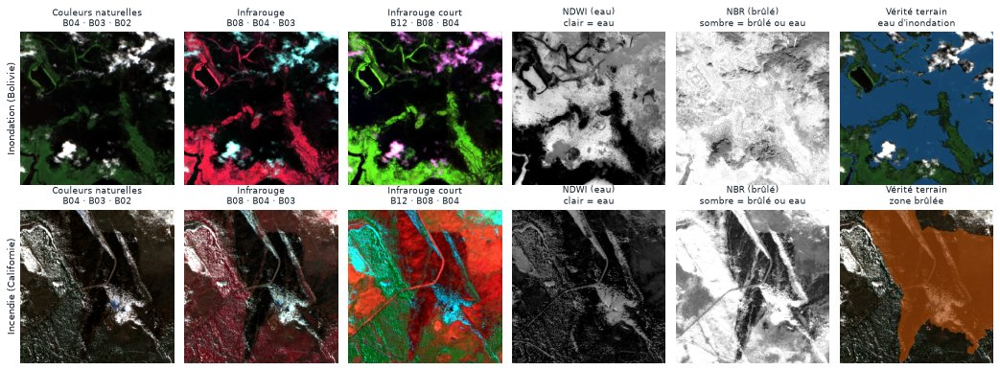

# Lire une image Sentinel-2

Une image Sentinel-2 n'est pas une photo : c'est une pile de **12 mesures** prises au même endroit, chacune dans une couleur de lumière différente, dont la plupart sont invisibles à l'œil. Le modèle reçoit ces mesures brutes. Pour les regarder, on en choisit trois et on les affiche en rouge, vert et bleu.

## Une tuile

| | |
|---|---|
| Taille | 512 × 512 pixels |
| Résolution | 10 m par pixel, soit environ 5 × 5 km au sol |
| Bandes | 12 (niveau L2A), du bleu à l'infrarouge à ondes courtes |
| Valeurs | Réflectance de surface × 10 000 : la part de lumière renvoyée par le sol (0 = rien, 10 000 = tout) |
| Fichier | GeoTIFF multibande, avec à côté la carte SCL (nuages, eau, neige) et, s'il existe, le masque de vérité terrain |

## Les bandes utiles

| Bande | Couleur de lumière | Longueur d'onde | Ce qu'elle montre |
|---|---|---|---|
| B02, B03, B04 | Bleu, vert, rouge | 490, 560, 665 nm | Ce que verrait l'œil |
| B08 | Proche infrarouge (PIR) | 842 nm | Très clair sur la végétation, presque noir sur l'eau |
| B11, B12 | Infrarouge à ondes courtes (SWIR) | 1 610, 2 190 nm | Sombre sur l'eau ; monte sur le sol brûlé et le sol nu |

Les autres bandes (B01, B05 à B07, B8A, B09) affinent la végétation et l'atmosphère. Le modèle de référence n'en garde que six : B02, B03, B04, B08, B11 et B12.

## Les signatures : pourquoi l'infrarouge voit l'eau et le brûlé

Chaque surface renvoie la lumière à sa façon selon la longueur d'onde : c'est sa **signature spectrale**. La figure ci-dessous est mesurée sur le jeu de données lui-même, à partir des masques de vérité terrain (40 tuiles d'inondation, 40 tuiles d'incendie).

<figure markdown="span">
  
  <figcaption>Réflectance médiane par bande. La terre sèche et la végétation remontent fortement dans le proche infrarouge (B08) ; l'eau reste basse et s'effondre en SWIR (B11, B12). Le sol brûlé, lui, reste plat en PIR et monte en SWIR.</figcaption>
</figure>

Trois lectures :

1. **L'eau absorbe l'infrarouge.** Au-delà de 1 000 nm, l'eau d'inondation et l'eau permanente sont les surfaces les plus sombres. C'est le signe le plus fiable de l'eau.
2. **L'eau d'inondation n'est pas l'eau permanente.** Elle est boueuse et peu profonde : plus claire dans le visible et le PIR que l'eau d'un lac ou de la mer. Un seuil réglé sur l'eau claire la sous-estime.
3. **Le brûlé inverse la pente.** La végétation saine est claire en PIR et plus sombre en SWIR ; après un feu, c'est l'inverse. L'indice NBR mesure cet écart.

## Les compositions colorées

On choisit trois bandes et on les affiche en rouge, vert et bleu. Selon le choix, les mêmes pixels prennent des couleurs très différentes.

<figure markdown="span">
  
  <figcaption>En haut : inondation en Bolivie (test). En bas : feu en Californie. De gauche à droite : couleurs naturelles, infrarouge, infrarouge court, NDWI, NBR, et la vérité terrain.</figcaption>
</figure>

| Composition | Bandes (R, V, B) | Végétation | Eau | Sol brûlé |
|---|---|---|---|---|
| Couleurs naturelles | B04, B03, B02 | vert | sombre, ou marron si boueuse | brun, gris |
| Infrarouge | B08, B04, B03 | **rouge** (le PIR passe dans le canal rouge) | noire, ou bleu-cyan si boueuse | brun sombre |
| Infrarouge court | B12, B08, B04 | vert vif | noire, bleu sombre | **rouge, orange** |

Ces couleurs ne sont qu'un affichage pour les humains : le modèle, lui, lit directement les valeurs des bandes.

## Les indices

Un indice combine deux bandes en un seul nombre entre −1 et 1, qui fait ressortir une surface :

| Indice | Formule | Repère | Piège |
|---|---|---|---|
| NDWI | (B03 − B08) / (B03 + B08) | Eau : valeur haute (clair sur la figure) | L'eau boueuse descend sous 0 : en L2A, le meilleur seuil est entre −0,35 et −0,2 |
| MNDWI | (B03 − B11) / (B03 + B11) | Eau, mieux séparée des villes | Neige et nuages aussi hauts |
| NBR | (B08 − B12) / (B08 + B12) | Sol brûlé : valeur basse (sombre) | **L'eau a aussi un NBR très bas** : sur une tuile côtière, la mer (−0,46) est plus basse que la zone brûlée (−0,31) |

Le dernier piège explique pourquoi un seuil seul ne suffit pas, et pourquoi le modèle doit combiner plusieurs bandes : NBR bas **et** SWIR haut pour le brûlé, SWIR très bas pour l'eau.

## La carte SCL

Chaque image L2A est livrée avec une carte de classification de scène (SCL), calculée par l'ESA : nuages, ombres, eau, neige, végétation, sol nu. Elle sert à mesurer la part de nuages de chaque tuile. Elle se trompe sur plusieurs pièges, comme la lave sombre classée en eau ou le salar classé en neige (voir [Eau permanente](water.md)). Ce n'est donc pas une vérité terrain.
