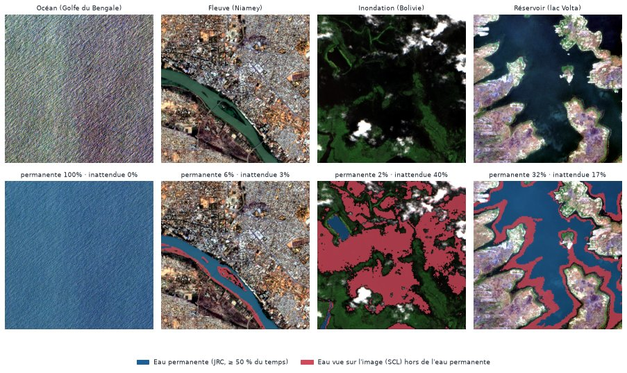

# Eau permanente : océans, lacs et cours d'eau

Une inondation, c'est de l'eau **là où il n'y en a pas d'habitude**. Une tuile qui montre la mer ou un fleuve dans son lit est normale. Pour faire la différence sur chaque tuile, il faut savoir où l'eau se trouve d'ordinaire.

## La carte JRC Global Surface Water

Le Centre commun de recherche de la Commission européenne (JRC) a cartographié l'eau de surface du globe à partir de 37 ans d'images Landsat (1984-2020). Pour chaque pixel de 30 m, la carte « occurrence » donne la **part des observations où le pixel était sous l'eau**.

Cette carte est lue sur la grille de chaque tuile, depuis Planetary Computer (collection `jrc-gsw`), et enregistrée à côté d'elle (`*_water.tif`, étape `water` de `scripts/build_dataset.py`, module `onelook.data.water`).

**Règle retenue :** un pixel est de l'eau permanente si l'eau y a été vue **au moins 50 % du temps**, ou s'il est hors de la couverture terrestre de JRC, c'est-à-dire en pleine mer.

**Choix du seuil :** chaque définition a été comparée à la couche « eau permanente » fournie avec Sen1Floods11, sur 40 tuiles :

| Définition | Recouvrement (IoU) |
|---|---|
| Occurrence ≥ 25 % | 0,71 |
| **Occurrence ≥ 50 %** | **0,90** |
| Occurrence ≥ 75 % | 0,76 |
| Occurrence ≥ 90 % | 0,54 |
| Eau les 12 mois de l'année | 0,73 |

<figure markdown="span">
  
  <figcaption>En bleu, l'eau permanente selon JRC. En rouge, l'eau que l'image montre (carte SCL) hors de l'eau permanente. L'océan et le fleuve sont presque entièrement « permanents ». L'inondation en Bolivie est presque entièrement « inattendue ». Le réservoir montre des berges noyées : son niveau était plus haut que d'habitude.</figcaption>
</figure>

## Deux mesures par tuile

| Colonne de l'index | Sens |
|---|---|
| `frac_permanent_jrc` | Part de la tuile en eau permanente |
| `scl_water_outside_jrc` | Part de la tuile où l'image montre de l'eau hors de l'eau permanente |

Sur les tuiles d'inondation, l'étiquette vient toujours du masque annoté à la main, déjà débarrassé de l'eau permanente. Sur les normales, la seconde mesure sert de contrôle.

## Les pièges d'eau

Ajoutés le 2 novembre au catalogue (21 sites × 4 années), et répartis dans les trois parties, océan compris en test :

| Catégorie | Entraînement | Validation | Test |
|---|---|---|---|
| Océan | 12 | 8 | 12 |
| Littoral | 4 | 0 | 8 |
| Estuaire | 4 | 4 | 4 |
| Lac | 4 | 4 | 4 |
| Réservoir | 8 | 4 | 4 |
| Rivière, fleuve | 8 | 8 | 12 |
| Lagune en ville | 8 | 0 | 0 |
| Rizières | 3 | 0 | 4 |
| **Total** | **51** | **28** | **48** |

## Contrôle des normales

24 normales montrent de l'eau hors de l'eau permanente sur au moins 5 % de la tuile. Vérifiées à l'œil, **aucune ne cache une inondation non annotée**. Ce sont quatre cas, tous normaux :

- **réservoirs** dont le niveau varie : berges noyées au-delà de la limite des 50 % (lac Volta, lacs de retenue californiens) ;
- **rizières inondées** (vallée de Sacramento) ;
- **erreurs de la carte SCL**, qui prend pour de l'eau la lave sombre de Lanzarote et les ombres des immeubles de Paris ;
- **eau saisonnière naturelle** : salar d'Uyuni sous une fine pellicule d'eau, zone humide en Australie.

**Conséquence :** « eau hors de l'eau permanente » ne veut pas dire « inondation ». Le modèle doit apprendre le contexte : une nappe qui recouvre des champs, des routes et des haies, et non une berge de réservoir ou une rizière.

## Ce que la carte n'est pas

La carte n'est **pas une entrée du modèle** : celui-ci décide à partir de l'image seule. Elle sert à vérifier les étiquettes, et à mesurer à part les fausses alertes sur l'eau permanente, l'indicateur qui dira si le modèle confond un fleuve avec une crue.

Deux pistes, ouvertes avec le mentor le 29 octobre, restent à évaluer :

- embarquer une version compressée de la carte à bord, comme bande supplémentaire : un satellite connaît sa position ;
- un petit modèle vision-langage (VLM), compressé, qui raisonne sur le contexte pour distinguer l'eau habituelle de l'inondation.
