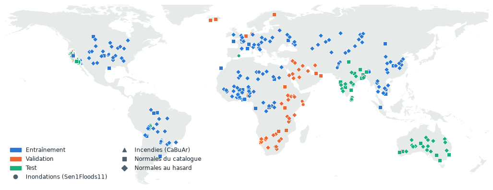
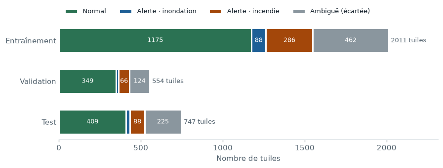

# Carnet de données

Le sujet impose de documenter la provenance, les licences, la composition, le découpage et les risques de fuite de chaque source. Cette page en donne la vue d'ensemble ; les pages suivantes détaillent chaque étape, avec des images.

| Page | Ce qu'elle explique |
|---|---|
| [Lire une image Sentinel-2](data/sentinel2.md) | Les bandes, les couleurs, les indices NDWI et NBR, et pourquoi l'infrarouge voit l'eau et le brûlé |
| [Harmonisation](data/harmonisation.md) | Pourquoi et comment toutes les images sont relues au même niveau L2A |
| [Images normales et pièges](data/normals.md) | D'où viennent les normales, et les paysages qui ressemblent à une anomalie |
| [Eau permanente](data/water.md) | Océans, lacs et cours d'eau : distinguer l'eau habituelle de l'inondation |
| [Étiquettes et découpage](data/labels_splits.md) | La décision attendue de chaque tuile, et la séparation entraînement / validation / test sans fuite |

## En chiffres

**3 312** tuiles 512 × 512

**12** bandes L2A à 10 m

**128 · 440** alertes inondation · incendie

**0** paire de tuiles à moins de 10 km entre deux parties

<figure markdown="span">
  
  <figcaption markdown="span">Position des tuiles. Chaque région entière va dans une seule partie : l'Asie du Sud et l'Australie en test, l'Afrique de l'Est et australe et le Moyen-Orient en validation. Les 2 460 tuiles CaBuAr, toutes en Californie, sont détaillées dans [Étiquettes et découpage](data/labels_splits.md).</figcaption>
</figure>

## Composition

Jeu complet constitué le 28 octobre et complété le 2 novembre (`scripts/build_dataset.py`) : **3 312 tuiles** 512 × 512 à 10 m, 12 bandes L2A, environ 16 Go. La décision attendue de chaque tuile suit `configs/labels.yaml` (voir [Étiquettes et découpage](data/labels_splits.md)).

<figure markdown="span">
  
  <figcaption>Décisions attendues par partie. Les tuiles ambiguës (un peu d'anomalie, pas assez pour alerter) sont écartées de l'entraînement et analysées à part.</figcaption>
</figure>

| Partie | Normal | Alerte · inondation | Alerte · incendie | Ambiguë (écartée) | Total |
|---|---|---|---|---|---|
| Entraînement | 1 175 | 88 | 286 | 462 | 2 011 |
| Validation | 349 | 15 | 66 | 124 | 554 |
| Test | 409 | 25 | 88 | 225 | 747 |
| **Total** | **1 933** | **128** | **440** | **811** | **3 312** |

Étiquettes v2 (6 novembre) : 377 normales californiennes recouvertes par un feu des 3 dernières années passent en ambiguës (voir [anciens feux](data/labels_splits.md#anciens-feux-des-normales-qui-nen-sont-pas)).

Origine des tuiles :

| Source | Tuiles | Rôle |
|---|---|---|
| Sen1Floods11, relu en L2A | 434 | inondations, et normales quand l'eau d'inondation est absente |
| CaBuAr, relu en L2A | 2 108 | zones brûlées ; les quarts non touchés sont des normales |
| CaBuAr, image avant feu | 352 | normales : le même lieu, avant l'incendie |
| Catalogue de sites | 233 | normales variées et pièges (neige, désert, lave, rizières, océans, fleuves, réservoirs…) |
| Points au hasard | 185 | normales tirées dans 15 régions du monde |

**Pertes :** 76 tâches n'ont pas abouti, soit 2,3 % :

- 34 sites normaux sans passage assez clair, ou assez nuageux pour les sites « nuages » ;
- 20 tuiles L2A incomplètes au bord des orbites ;
- 17 tuiles CaBuAr dont la lecture distante échoue à chaque essai ;
- 5 tuiles CaBuAr dont la position n'a pas été retrouvée (corrélation trop faible).

Les images Inconnu (éruptions, glissements, marées noires) formeront un lot à part, seulement en test, jamais en entraînement.

## Sources et licences

| Source | Contenu | Capteur | Licence | Utilisée pour |
|---|---|---|---|---|
| Sen1Floods11 | Inondations, 11 événements, 446 tuiles 512 × 512 annotées à la main | Sentinel-2 L1C (Sentinel-1 non utilisé) | À vérifier : aucune licence dans le dépôt GitHub | Alerte inondation |
| CaBuAr | Zones brûlées, Californie, avant et après feu, 534 tuiles 512 × 512 | Sentinel-2 L2A (masques CAL FIRE) | CDLA-Permissive-2.0 | Alerte incendie |
| Sentinel-2 L2A, Microsoft Planetary Computer (`sentinel-2-l2a`) | Toutes les images, relues au même niveau | Sentinel-2 | Données Copernicus : accès libre et gratuit | Harmonisation de toutes les tuiles |
| JRC Global Surface Water 1984-2020 (Planetary Computer, `jrc-gsw`) | Occurrence de l'eau par pixel, 30 m | Landsat | Réutilisation libre avec citation (Commission européenne, JRC) — à confirmer | Eau permanente (étiquettes et évaluation, pas entrée du modèle) |
| NIFC InterAgency Fire Perimeter History (ArcGIS, `InterAgencyFirePerimeterHistory_All_Years_View`) | Périmètres des feux de Californie 2012-2022, dont ceux de CAL FIRE | – | Domaine public (données du gouvernement fédéral américain) — à confirmer | Anciens feux : normales californiennes passées en ambiguës (étiquettes seulement) |
| Natural Earth | Contours des terres | – | Domaine public | Fond des cartes de cette documentation |
| CloudSEN12 | Nuages et ombres | Sentinel-2 | À vérifier | Images normales difficiles (piste) |
| Copernicus Browser / Copernicus EMS | Éruptions, glissements de terrain, marées noires… | Sentinel-2 | À vérifier | Test de l'inconnu |
| xBD / xView2 | Dégâts aux bâtiments | Maxar, RGB ~0,5 m | – | **Écarté** : résolution et capteur incompatibles avec Sentinel-2 (voir [Cadrage](framing.md)) |

## Risques de fuite

| Risque | Parade |
|---|---|
| Tuiles voisines d'une même scène réparties entre entraînement et test | Découpage par groupe, contrôle à 10 km |
| Même lieu brûlé à plusieurs dates dans des parties différentes | Zones spatiales au lieu des plis CaBuAr |
| Avant et après d'un même feu dans deux parties différentes | L'image avant feu suit sa zone |
| Niveaux L1C et L2A mélangés : le modèle reconnaîtrait la source au lieu du phénomène | Tout relu en L2A depuis Planetary Computer |
| Toutes les zones brûlées en Californie | Limite assumée ; test complémentaire sur des feux d'autres régions à prévoir |

## Biais et limites

- **Californie surreprésentée chez les normales.** 1 387 des 1 933 normales, soit 72 %, sont des quarts CaBuAr non brûlés ou des images avant feu. Un modèle pourrait associer « paysage californien » et « feu ». Parades prévues : pondérer les normales par source à l'entraînement, et mesurer les fausses alertes séparément sur les normales hors Californie.
- **Peu d'inondations.** 128 alertes seulement, dont 25 en test : les mesures de rappel sur les inondations auront une forte incertitude, à indiquer avec un intervalle.
- **Inondations nuageuses.** Beaucoup de tuiles d'inondation sont prises en saison des pluies, avec des nuages : la part d'inondation est comptée sur la tuile entière, donc l'eau cachée ne déclenche pas d'alerte attendue.
- **Anciens feux hors fenêtre** : une cicatrice de plus de 3 ans, ou un feu absent de l'historique (petits brûlis), peut encore rester dans une normale californienne.
- **Feux d'une seule région et d'un seul type** (végétation méditerranéenne californienne) : la généralisation à d'autres biomes n'est pas garantie.
- **Points au hasard non vérifiés un par un** : un point peut tomber sur une anomalie non annotée (crue locale, brûlis agricole). Le contrôle d'[eau inattendue](data/water.md#controle-des-normales) en couvre une partie.
- **Tuiles ambiguës écartées** (811, dont 377 pour un ancien feu) : elles seront analysées à part, car c'est là que le modèle hésitera le plus.

## Reproduire

Le jeu se reconstruit entièrement avec `scripts/build_dataset.py`, et les figures de ces pages avec `scripts/make_figures.py` (voir [Reproduire](reproduce.md)).
