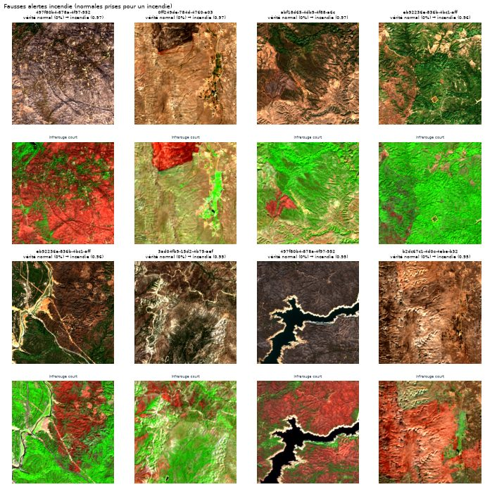
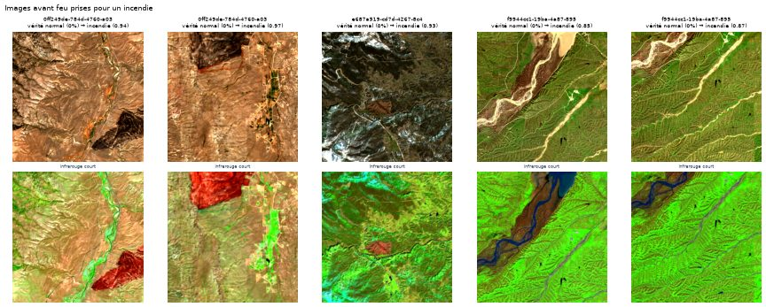
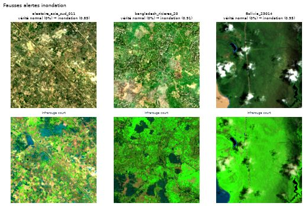
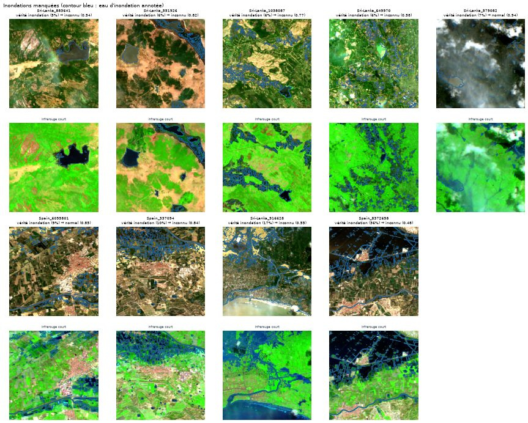
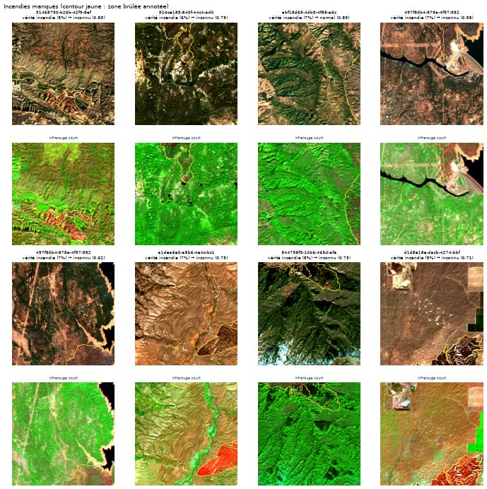

# Limites et échecs

Le sujet demande une analyse des cas d'échec. Cette page décrit les erreurs du premier réseau (MobileNetV3-Small, 256 px, avec « inconnu ») sur le **jeu de test**, image par image : ce que le modèle a répondu, la bonne réponse, et l'explication la plus probable.

Les planches sont produites par `scripts/failure_figures.py` à partir des décisions enregistrées (`runs/mobilenet_v3_small_256/decisions_test_model.csv`). Chaque tuile est montrée deux fois : en couleurs naturelles, puis en **infrarouge court** (B12, B08, B04), où le sol brûlé ressort en rouge-brun, l'eau en noir ou bleu sombre et la végétation en vert. Le contour bleu marque l'eau d'inondation annotée, le contour jaune la zone brûlée annotée. Le titre donne la vérité, la décision et la confiance du modèle.

## Vue d'ensemble

| Erreur | Nombre (test) | Explication principale |
|---|---|---|
| Normale → alerte incendie | 17 sur 530 | Anciennes cicatrices de feu absentes du masque (erreur d'étiquette), sols sombres |
| Normale → alerte inondation | 3 sur 530 | Eau saisonnière : rizières, petits réservoirs |
| Inondation manquée | 9 sur 25 | Réservoirs et rizières annotés « inondation », eau en filets fins, nuages |
| Incendie manqué | 17 sur 88 | Petites zones brûlées coupées par le bord de la tuile, périmètres qui englobent de la végétation intacte |

## Fausses alertes incendie : d'anciennes cicatrices

Les 17 fausses alertes incendie sont **toutes californiennes** : 12 quarts CaBuAr sans brûlé annoté et 5 images avant feu. Hors Californie, aucune normale n'est prise pour un incendie.

<figure markdown="span">
  
  <figcaption>Les 8 fausses alertes les plus sûres. En infrarouge court, la plupart montrent de grandes zones rouge-brun, la couleur du brûlé, parfois à bord net (2e tuile).</figcaption>
</figure>

Le rouge-brun peut venir d'une ancienne cicatrice de feu, ou de sol nu et d'herbe sèche d'été. Les **images avant feu** permettent de trancher : prises avant l'incendie annoté, elles ne devraient montrer aucun brûlé lié à cet incendie.

<figure markdown="span">
  
  <figcaption>Les 5 images avant feu prises pour un incendie. Les deux premières (fin août 2019) montrent déjà des zones noires à bord net, rouge vif en infrarouge court : la cicatrice d'un feu plus ancien. Les deux dernières montrent un lit de rivière sombre : une vraie erreur du modèle.</figcaption>
</figure>

Mesure à l'appui : la part de pixels au « brûlé apparent » (NBR < −0,05 et hors eau) couvre en moyenne **42 %** de la tuile sur les 17 fausses alertes, contre **18 %** sur les 400 normales californiennes bien classées.

**Conclusion :** une partie de ces fausses alertes sont des **erreurs d'étiquette**. CaBuAr n'annote que l'incendie de l'événement ; les cicatrices des feux précédents, réelles et parfois récentes, restent « normales ». Deux conséquences :

- le taux de fausses alertes incendie mesuré (3,2 % des normales) est **surestimé** ;
- à l'entraînement, ces tuiles apprennent au modèle à ignorer de vraies cicatrices, ce qui peut lui coûter des détections.

**Correction appliquée (6 novembre) :** les périmètres de l'historique fédéral NIFC (qui regroupe ceux de CAL FIRE) des 3 années précédant l'image, plus celle de l'image, sont croisés avec chaque tuile de Californie. Une normale recouverte à plus de 0,5 % passe en ambiguë (détail dans [Étiquettes et découpage](data/labels_splits.md#anciens-feux-des-normales-qui-nen-sont-pas)).

- **9 des 17 fausses alertes** sont recouvertes par un feu récent. Les deux images avant feu de fin août 2019 le sont par le feu Long Valley de juillet 2019 : la « cicatrice plus ancienne » vue sur la planche était fraîche de quelques semaines.
- Les normales recouvertes déclenchent près de trois fois plus de fausses alertes que les autres (7,4 % contre 2,7 %).
- **Même modèle, étiquettes v2 :** la précision incendie passe de 81 à 90 %, et les fausses alertes de 3,8 à 2,7 %. Rien n'a changé dans le modèle, seulement dans ce qu'on lui reprochait.

Les 8 fausses alertes restantes (sols sombres, lits de rivière, brûlis absents de l'historique) sont de vraies erreurs du modèle. Le réentraînement sur les étiquettes v2 dira si un apprentissage plus propre les réduit.

## Fausses alertes inondation : l'eau saisonnière

<figure markdown="span">
  
  <figcaption>Les 3 fausses alertes inondation : petits plans d'eau épars en Inde (point au hasard), rizières en eau au Bangladesh, et une tuile de Bolivie sous le seuil d'alerte (rivière et mares).</figcaption>
</figure>

Les trois cas mêlent de l'eau saisonnière normale à un paysage agricole. Sur les 48 pièges d'eau du test (océan, fleuves, lacs, réservoirs, rizières), c'est la seule erreur, sur les rizières : l'océan et les grands fleuves ne posent plus de problème.

## Inondations manquées : une frontière floue

<figure markdown="span">
  
  <figcaption>Les 9 inondations manquées, de la plus petite à la plus grande part d'inondation. 7 sont passées en « inconnu », 2 en « normal ».</figcaption>
</figure>

| Cas | Tuiles | Ce qu'on voit |
|---|---|---|
| Plan d'eau compact | 2 (Sri Lanka) | Un seul lac aux bords nets, sans doute un **réservoir d'irrigation saisonnier**, absent de l'eau permanente JRC et donc annoté « inondation » |
| Eau éparse dans les champs | 2 (Sri Lanka) | Des parcelles en eau, très proches des **rizières** qui sont des normales dans le catalogue |
| Filets d'eau fins | 3 (Espagne, Sri Lanka) | Eau le long des cours d'eau, des parcelles ou du littoral, sur 9 à 17 % de la tuile |
| Nuages | 1 (Sri Lanka) | Tuile couverte à 96 % de nuages |
| Vraie erreur | 1 (Espagne, 36 %) | Image très sombre, grande nappe ; le modèle hésite (confiance 0,48) |

**Conclusion :** la moitié des inondations manquées tient à une **frontière de définition** plutôt qu'à une faiblesse du modèle. Le jeu de données dit à la fois « rizières en eau = normal » (pièges du catalogue) et « parcelles en eau au Sri Lanka = inondation » (Sen1Floods11). Le modèle hésite donc, ce qui est cohérent, et répond le plus souvent « inconnu », ce qui envoie quand même la tuile au sol.

C'est exactement la question du contexte (où est l'eau habituellement ?) que la piste du petit VLM, ouverte par le mentor, ou une carte d'eau permanente embarquée pourraient aider à résoudre.

## Incendies manqués : petites zones, périmètres larges

<figure markdown="span">
  
  <figcaption>Les 8 incendies manqués les plus petits (5 à 9 % de la tuile). La zone brûlée annotée (contour jaune) touche souvent le bord de la tuile, ou englobe de la végétation restée verte.</figcaption>
</figure>

- La zone brûlée médiane des incendies manqués couvre **9 %** de la tuile, contre **32 %** pour les incendies détectés.
- Les zones touchent souvent le **bord de la tuile** : le modèle n'en voit qu'un morceau, sans le contexte du feu.
- Les masques viennent des **périmètres** CAL FIRE : ils englobent des îlots de végétation intacte ou peu touchée (3e tuile). Une partie du « brûlé annoté » n'est pas visible comme tel.
- Une image réduite à 256 × 256 perd les détails fins : l'essai à 512 px dira si la pleine résolution aide.

## Inconnus et tuiles ambiguës

- **47 tuiles du test (7 %) passent en « inconnu »**, dont 26 normales, souvent des quarts CaBuAr en bord de zone brûlée. « Inconnu » attrape surtout des cas limites, ce qui est son rôle. Son efficacité sur de vrais phénomènes jamais vus (éruptions, glissements, marées noires) reste à mesurer avec le lot dédié.
- Sur les **104 tuiles ambiguës** (entre 0,5 et 5 % d'anomalie), le réseau répond « normal » 56 fois, « inconnu » 28 fois et alerte 20 fois. C'est cohérent : ces tuiles sont exactement à la frontière.

## Pistes d'amélioration, par ordre d'effet attendu

1. ~~Nettoyer les étiquettes incendie~~ avec l'historique des périmètres de feux : fait le 6 novembre (étiquettes v2), réentraînement en cours.
2. **Clarifier l'eau saisonnière** : décider, avec le mentor, si une rizière ou un réservoir saisonnier en eau mérite une alerte, et rendre les étiquettes cohérentes avec ce choix.
3. **Entraîner à 512 px** pour les petites zones brûlées et les filets d'eau, et mesurer le coût en temps.
4. **Régler le seuil « inconnu »** selon la priorité : moins de fausses alertes, ou plus de détections.

## Limites connues

- 25 inondations en test : une tuile représente 4 points de rappel.
- Tous les incendies sont californiens, y compris en test.
- Le seuil « inconnu » est calibré sur 501 tuiles de validation, dont 15 inondations.
- Les étiquettes incendie v2 écartent les cicatrices de moins de 3 ans connues de l'historique ; un brûlis plus ancien ou non répertorié peut encore rester dans une normale.
