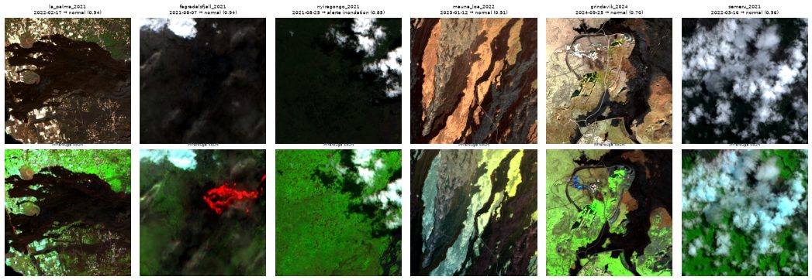
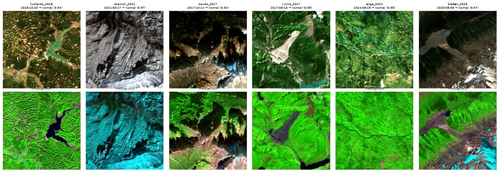
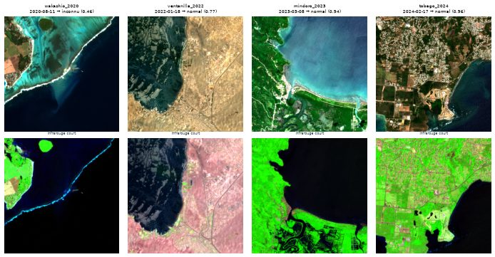

# Limites et échecs

Le sujet demande une analyse des cas d'échec. Cette page décrit d'abord les erreurs du premier réseau (MobileNetV3-Small, 256 px, étiquettes v1, avec « inconnu ») sur le **jeu de test**, puis ce qui reste après la correction des étiquettes et le réentraînement à 512 px ([plus bas](#apres-correction-512-px-etiquettes-v3)), image par image : ce que le modèle a répondu, la bonne réponse, et l'explication la plus probable.

Les planches sont produites par `scripts/failure_figures.py` à partir des décisions enregistrées (`runs/mobilenet_v3_small_256/decisions_test_model.csv`). Chaque tuile est montrée deux fois : en couleurs naturelles, puis en **infrarouge court** (B12, B08, B04), où le sol brûlé ressort en rouge-brun, l'eau en noir ou bleu sombre et la végétation en vert. Le contour bleu marque l'eau d'inondation annotée, le contour jaune la zone brûlée annotée. Le titre donne la vérité, la décision et la confiance du modèle.

## Vue d'ensemble

| Erreur | Nombre (test) | Explication principale |
|---|---|---|
| Normale → alerte incendie | 17 sur 530 | Anciennes cicatrices de feu absentes du masque (erreur d'étiquette), sols sombres |
| Normale → alerte inondation | 3 sur 530 | Eau saisonnière : rizières, petits réservoirs |
| Inondation manquée | 9 sur 25 | Réservoirs et rizières annotés « inondation », eau en filets fins, nuages |
| Incendie manqué | 17 sur 88 | Petites zones brûlées coupées par le bord de la tuile, périmètres qui englobent de la végétation intacte |

## Fausses alertes incendie : d'anciennes cicatrices

Les 17 fausses alertes incendie sont **toutes californiennes** : 12 quarts CaBuAr sans brûlé annoté et 5 images avant feu. Hors Californie, aucune normale n'est prise pour un incendie.

<figure markdown="span">
  
  <figcaption>Les 8 fausses alertes les plus sûres. En infrarouge court, la plupart montrent de grandes zones rouge-brun, la couleur du brûlé, parfois à bord net (2e tuile).</figcaption>
</figure>

Le rouge-brun peut venir d'une ancienne cicatrice de feu, ou de sol nu et d'herbe sèche d'été. Les **images avant feu** permettent de trancher : prises avant l'incendie annoté, elles ne devraient montrer aucun brûlé lié à cet incendie.

<figure markdown="span">
  
  <figcaption>Les 5 images avant feu prises pour un incendie. Les deux premières (fin août 2019) montrent déjà des zones noires à bord net, rouge vif en infrarouge court : la cicatrice d'un feu plus ancien. Les deux dernières montrent un lit de rivière sombre : une vraie erreur du modèle.</figcaption>
</figure>

Mesure à l'appui : la part de pixels au « brûlé apparent » (NBR < −0,05 et hors eau) couvre en moyenne **42 %** de la tuile sur les 17 fausses alertes, contre **18 %** sur les 400 normales californiennes bien classées.

**Conclusion :** une partie de ces fausses alertes sont des **erreurs d'étiquette**. CaBuAr n'annote que l'incendie de l'événement ; les cicatrices des feux précédents, réelles et parfois récentes, restent « normales ». Deux conséquences :

- le taux de fausses alertes incendie mesuré (3,2 % des normales) est **surestimé** ;
- à l'entraînement, ces tuiles apprennent au modèle à ignorer de vraies cicatrices, ce qui peut lui coûter des détections.

**Correction appliquée (étiquettes v3, 9 novembre) :** les périmètres de l'historique fédéral NIFC (qui regroupe ceux de CAL FIRE) de l'année de l'image et de l'année précédente sont croisés avec chaque tuile de Californie. Une normale recouverte à plus de 0,5 % passe en ambiguë (détail dans [Étiquettes et découpage](data/labels_splits.md#anciens-feux-des-normales-qui-nen-sont-pas)).

- **15 des 17 fausses alertes** sont recouvertes par un feu récent. Les deux images avant feu de fin août 2019 le sont par le feu Long Valley de juillet 2019 : la « cicatrice plus ancienne » vue sur la planche était fraîche de quelques semaines.
- Les normales recouvertes déclenchent une fausse alerte incendie dans 15 % des cas, les autres dans 0,6 % des cas.
- **Même modèle, étiquettes v3 :** la précision incendie passe de 81 à 97 %, et les fausses alertes de 3,8 à 1,2 %. Rien n'a changé dans le modèle, seulement dans ce qu'on lui reprochait.

Les 2 fausses alertes restantes sont les images avant feu du lit de rivière sombre : de vraies erreurs du modèle.

Une première version de cette correction (v2, 6 novembre) utilisait un historique presque vide après 2019 et n'expliquait que 9 des 17 fausses alertes. L'examen des erreurs du réseau à 512 px a révélé le trou.

## Fausses alertes inondation : l'eau saisonnière

<figure markdown="span">
  
  <figcaption>Les 3 fausses alertes inondation : petits plans d'eau épars en Inde (point au hasard), rizières en eau au Bangladesh, et une tuile de Bolivie sous le seuil d'alerte (rivière et mares).</figcaption>
</figure>

Les trois cas mêlent de l'eau saisonnière normale à un paysage agricole. Sur les 48 pièges d'eau du test (océan, fleuves, lacs, réservoirs, rizières), c'est la seule erreur, sur les rizières : l'océan et les grands fleuves ne posent plus de problème.

## Inondations manquées : une frontière floue

<figure markdown="span">
  
  <figcaption>Les 9 inondations manquées, de la plus petite à la plus grande part d'inondation. 7 sont passées en « inconnu », 2 en « normal ».</figcaption>
</figure>

| Cas | Tuiles | Ce qu'on voit |
|---|---|---|
| Plan d'eau compact | 2 (Sri Lanka) | Un seul lac aux bords nets, sans doute un **réservoir d'irrigation saisonnier**, absent de l'eau permanente JRC et donc annoté « inondation » |
| Eau éparse dans les champs | 2 (Sri Lanka) | Des parcelles en eau, très proches des **rizières** qui sont des normales dans le catalogue |
| Filets d'eau fins | 3 (Espagne, Sri Lanka) | Eau le long des cours d'eau, des parcelles ou du littoral, sur 9 à 17 % de la tuile |
| Nuages | 1 (Sri Lanka) | Tuile couverte à 96 % de nuages |
| Vraie erreur | 1 (Espagne, 36 %) | Image très sombre, grande nappe ; le modèle hésite (confiance 0,48) |

**Conclusion :** la moitié des inondations manquées tient à une **frontière de définition** plutôt qu'à une faiblesse du modèle. Le jeu de données dit à la fois « rizières en eau = normal » (pièges du catalogue) et « parcelles en eau au Sri Lanka = inondation » (Sen1Floods11). Le modèle hésite donc, ce qui est cohérent, et répond le plus souvent « inconnu », ce qui envoie quand même la tuile au sol.

C'est exactement la question du contexte (où est l'eau habituellement ?) que la piste du petit VLM, ouverte par le mentor, ou une carte d'eau permanente embarquée pourraient aider à résoudre.

## Incendies manqués : petites zones, périmètres larges

<figure markdown="span">
  
  <figcaption>Les 8 incendies manqués les plus petits (5 à 9 % de la tuile). La zone brûlée annotée (contour jaune) touche souvent le bord de la tuile, ou englobe de la végétation restée verte.</figcaption>
</figure>

- La zone brûlée médiane des incendies manqués couvre **9 %** de la tuile, contre **32 %** pour les incendies détectés.
- Les zones touchent souvent le **bord de la tuile** : le modèle n'en voit qu'un morceau, sans le contexte du feu.
- Les masques viennent des **périmètres** CAL FIRE : ils englobent des îlots de végétation intacte ou peu touchée (3e tuile). Une partie du « brûlé annoté » n'est pas visible comme tel.
- Une image réduite à 256 × 256 perd les détails fins : l'essai à 512 px dira si la pleine résolution aide.

## Après correction : 512 px, étiquettes v3

Réseau de référence : réentraîné à pleine résolution sur les étiquettes v3, seuil « inconnu » 0,67 (voir [Résultats](results.md#le-seuil-inconnu)), même jeu de test. La colonne « 512 px v2 » est le réseau à pleine résolution entraîné avant la correction ; la colonne « seuil strict » est le réseau v3 avec l'ancien seuil (0,83).

<figure markdown="span">
  
  <figcaption>Matrice de confusion du réseau à 512 px entraîné en v3, seuil 0,67, sur le test (546 tuiles hors ambiguës).</figcaption>
</figure>

| Erreur | Premier réseau | 512 px v2 | 512 px v3, seuil strict | **512 px v3** | Ce qui reste |
|---|---|---|---|---|---|
| Normale → alerte incendie | 2 | 4 | 1 | **3** | 1 tuile de désert (nord du Mojave), 2 images avant feu (un lit de rivière sombre) |
| Normale → alerte inondation | 3 | 2 | 1 | **3** | Rizières au Bangladesh, estuaire de la Hooghly, mares en Bolivie |
| Inondation manquée | 9 | 7 | 10 | **7** | 6 entre 5 et 10 % de la tuile, 1 à 20 % en « inconnu » |
| Incendie manqué | 17 | 5 | 5 | **4** | 2 petites zones (5 à 7 %), 2 tuiles à 21 et 22 % du même feu |

<figure markdown="span">
  
  <figcaption>Les 7 inondations manquées par le réseau à 512 px v3, de la plus petite à la plus grande part d'inondation (titre : vérité, décision et confiance). 5 sont prises pour normales (4 au Sri Lanka, 1 en Espagne), 2 vont en « inconnu ».</figcaption>
</figure>

- **Les fausses alertes qui restent sont de vraies erreurs, pas des étiquettes fausses.** Côté incendie : une tuile de désert et un lit de rivière sombre, dont la signature en infrarouge court ressemble à celle du brûlé. Côté inondation : de l'eau saisonnière ou mouvante (rizières, estuaire, mares) que la définition d'« inondation » ne tranche pas. Avec le seuil strict, 4 de ces 6 tuiles passaient en « inconnu ».
- **Les inondations manquées restent à la frontière.** 6 des 7 font entre 5 et 10 % de la tuile, juste au-dessus du seuil d'alerte (5 détectées sur 11 dans cette tranche, contre 13 sur 14 au-delà de 10 %). Les 4 tuiles du Sri Lanka sont prises pour normales avec assurance (confiance de 0,70 à 0,97) : l'eau y occupe des réservoirs ou des étangs que le réseau prend pour une eau habituelle.
- **Ce n'est pas un effet du déséquilibre des classes.** Le réseau ne rechigne pas à alerter inondation (3 fausses alertes), et les petites inondations pèsent autant à l'entraînement (43 %) qu'en test (48 %). Ce qui manque, c'est la **variété** : 88 inondations d'entraînement, 6 pays.
- **Les incendies manqués sont les mêmes** qu'avec le 512 px v2, moins un : la tuile brûlée à 97 % qui passait en « inconnu » est maintenant détectée. Restent deux petites zones et deux quarts d'un même feu, à 21 et 22 %.

<figure markdown="span">
  
  <figcaption>Pour mémoire : les 12 fausses alertes incendie du réseau à 512 px v2 avec les étiquettes v2. Avec l'historique complet des feux, 8 sont recouvertes par un feu de l'année de l'image ou de la précédente (les tuiles rouge-brun en infrarouge court) ; restent 2 tuiles de désert et 2 lits de rivière. Le réseau v3 garde 1 tuile de désert et les 2 lits de rivière.</figcaption>
</figure>

## Inconnus et tuiles ambiguës

- **20 tuiles du test (2,7 %) passent en « inconnu »** avec le réseau v3 et le seuil 0,67 : 7 normales, 2 inondations et 11 tuiles ambiguës. Avec le seuil strict, c'était 55 tuiles (7 %). « Inconnu » attrape surtout des cas limites, ce qui est son rôle. Sur de vrais phénomènes jamais vus, en revanche, il ne marche pas ([plus bas](#phenomenes-jamais-vus-le-lot-inconnu)).
- Sur les **201 tuiles ambiguës**, le réseau répond « normal » 136 fois, « inconnu » 11 fois et alerte 54 fois. 159 de ces tuiles sont des normales recouvertes par un feu récent : le réseau alerte incendie sur 50 d'entre elles, ce qui confirme que ces cicatrices se voient bien sur l'image.

## Phénomènes jamais vus : le lot « inconnu »

Le modèle doit répondre Inconnu devant un phénomène qu'il n'a jamais appris. Pour le vérifier, 16 tuiles d'événements réels (`configs/unknown_events.yaml`, `scripts/unknown_set.py`), lues comme toutes les autres en L2A sur Planetary Computer, au passage le plus dégagé après l'événement : 6 éruptions, 6 glissements de terrain, 4 marées noires. Elles ne servent ni à l'entraînement, ni au calibrage du seuil.

**Chaque tuile est d'abord vérifiée à l'œil** : le phénomène doit se voir. Seules 7 tuiles passent ce filtre.

- Éruptions : coulées de La Palma, du Mauna Loa et de Grindavík, lave encore chaude à Fagradalsfjall (rouge vif en infrarouge court). Le Semeru est sous les nuages ; la coulée du Nyiragongo n'apparaît pas sur la tuile (coordonnées à revoir).
- Glissements : versants arrachés d'Hokkaido, cicatrice de Xinmo, dépôt de Blatten. Chamoli (neige), Bondo et Enga ne montrent pas de dépôt lisible à 10 m.
- Marées noires : **aucune nappe visible** sur les 4 tuiles. Une nappe d'hydrocarbures est fine et change vite ; à 10 m et à la date du passage, l'image ressemble à une côte ordinaire. Ce phénomène est hors de portée de Sentinel-2 dans ce format (le radar Sentinel-1, exclu du projet, est l'outil habituel).

| Tuiles où le phénomène se voit | Réseau 512 px v3 | Réseau 256 px v3 |
|---|---|---|
| 4 éruptions | 4 « normal » (confiance 0,70 à 0,94) | 3 « normal », 1 « inconnu » (Mauna Loa) |
| 3 glissements | 3 « normal » (0,94 à 0,97) | 2 « normal », 1 « inconnu » (Xinmo) |

<figure markdown="span">
  
  <figcaption>Éruptions : couleurs naturelles en haut, infrarouge court en bas ; titre : date, décision et confiance du réseau à 512 px v3.</figcaption>
</figure>

<figure markdown="span">
  
  <figcaption>Glissements de terrain. Hokkaido, Xinmo et Blatten montrent clairement les versants arrachés ou les dépôts ; le réseau y voit un paysage normal.</figcaption>
</figure>

<figure markdown="span">
  
  <figcaption>Marées noires : aucune nappe n'est visible. Ces tuiles ne permettent pas de juger le modèle.</figcaption>
</figure>

**Ce qu'on en tire : la confiance ne suffit pas à détecter l'inconnu.** Le réseau n'a appris que trois réponses ; devant une coulée de lave ou un versant arraché, il choisit la plus proche, « normal », souvent avec assurance. C'est une limite connue des réseaux de classification : une forte confiance veut dire « loin des autres classes apprises », pas « proche de ce que j'ai vu ». Le seuil abaissé à 0,67 n'est pas en cause : même avec l'ancien seuil (0,83), le réseau à 512 px n'aurait répondu « inconnu » que pour Grindavík.

Rien d'alarmant pour la mission elle-même : aucune de ces tuiles ne déclenche de fausse alerte (une seule tuile non lisible, au Nyiragongo, déclenche une alerte inondation). Mais la promesse « inconnu » n'est pas tenue.

**Essai rapide d'un autre signal**, sur les descripteurs internes du réseau (les 576 valeurs avant la décision) : la distance de Mahalanobis au plus proche nuage de tuiles d'entraînement (150 par classe). Réglée pour envoyer 5 % des tuiles du test en « inconnu », elle attrape 2 des 4 éruptions visibles (Fagradalsfjall, Mauna Loa) et aucun glissement. L'énergie des scores de sortie fait moins bien. Signal réel mais faible, mesuré sur 7 tuiles : c'est une piste, pas un résultat.

## Pistes d'amélioration, par ordre d'effet attendu

1. ~~Nettoyer les étiquettes incendie~~ avec l'historique des périmètres de feux : fait (étiquettes v3, 9 novembre), puis réentraînement.
2. **Clarifier l'eau saisonnière** : décider, avec le mentor, si une rizière, un estuaire ou un réservoir saisonnier en eau mérite une alerte, et rendre les étiquettes cohérentes avec ce choix. C'est maintenant la première source de fausses alertes inondation.
3. **Plus d'inondations, et plus variées** (WorldFloods, licence à vérifier) : 88 tuiles de 6 pays, c'est le point faible.
4. ~~Régler le seuil « inconnu »~~ : fait, 98 % des bonnes réponses de validation gardées au lieu de 95 % ; à revoir avec le lot de phénomènes jamais vus.
5. ~~Entraîner à 512 px~~ : fait, la pleine résolution aide les petites zones pour le double du temps.
6. **Détecter l'inconnu autrement que par la confiance** : distance aux descripteurs d'entraînement (Mahalanobis), à mesurer sur un lot plus grand ; ou apprendre une classe « autre » à partir de paysages variés, au risque de ne couvrir que les phénomènes prévus.

## Limites connues

- 25 inondations en test : une tuile représente 4 points de rappel.
- Tous les incendies sont californiens, y compris en test.
- Le seuil « inconnu » est calibré sur 447 tuiles de validation (hors ambiguës), dont 15 inondations.
- Les étiquettes incendie v3 écartent les cicatrices de l'année de l'image et de l'année précédente connues de l'historique ; un brûlis plus ancien ou non répertorié peut encore rester dans une normale.
