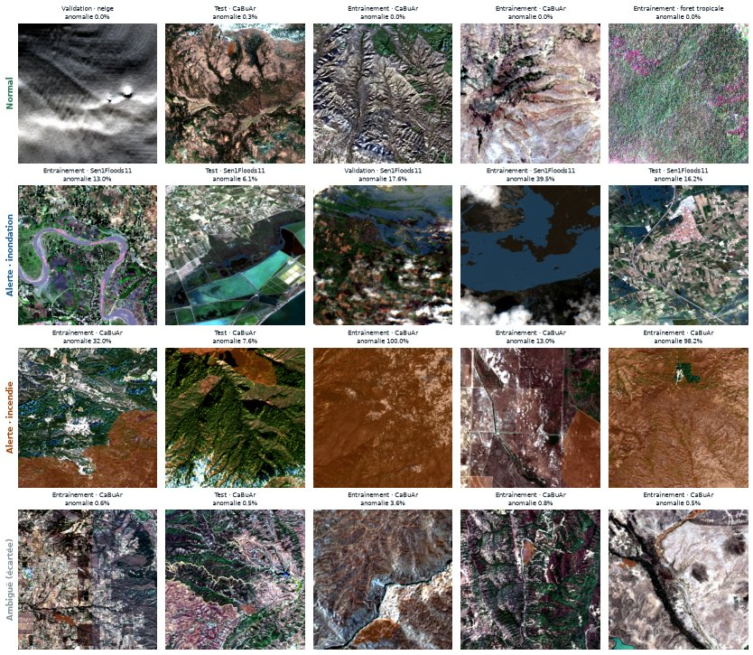

# One Look

Un modèle d'IA léger, capable de tourner à bord d'un satellite, qui regarde une image une seule fois et décide si elle mérite une alerte.

## Une image, quatre décisions

| Décision | Signification |
|---|---|
| Normal | Rien à signaler, y compris les nuages, les rivières, les lacs et les champs. |
| Alerte · inondation | Une part importante de l'image est inondée. |
| Alerte · incendie | Une part importante de l'image a brûlé récemment. |
| Inconnu | L'image ne ressemble à rien de ce que le modèle connaît. Elle est envoyée au sol pour vérification. |

<figure markdown="span">
  
  <figcaption markdown="span">Des tuiles du jeu de données pour chaque décision attendue, avec la vérité terrain en surimpression. Détails dans le [Carnet de données](data_card.md).</figcaption>
</figure>

## Pourquoi c'est utile

Les satellites produisent plus d'images qu'on ne peut en envoyer au sol. Un modèle embarqué qui trie les images à bord permet de transmettre d'abord celles qui comptent. Il doit pour cela tenir dans peu de mémoire, répondre vite et ne pas alerter pour rien.

## Ce que le projet évalue

- **Qualité des alertes** : précision et rappel, avec un protocole documenté.
- **Fausses alertes** : taux d'alertes sur des images normales.
- **L'inconnu** : capacité à signaler ce que le modèle n'a jamais vu.
- **Embarquabilité** : taille du modèle en Mo et temps d'inférence en ms.
- **Cas d'échec** : analyse des erreurs.

## Le projet en bref

| | |
|---|---|
| Cadre | Piscine Intelligence Lab · Makers, projet individuel |
| Période | 16 octobre → 16 novembre 2026 |
| Données | Images Sentinel-2, GeoTIFF 512 × 512 pixels |
| Anomalies | Inondations et incendies |
| Outils | Python, PyTorch, TorchGeo, ONNX Runtime ; démo : FastAPI, globe.gl, d3 |
| Code | [elfried96/onelook-alert_Elf](https://github.com/elfried96/onelook-alert_Elf) |

## Où en est le projet

| | |
|---|---|
| Modèle de référence | MobileNetV3-Small, image entière à 512 px, 6 bandes Sentinel-2 · 6,1 Mo · environ 15 ms par image sur un cœur de processeur |
| Sur le test (zones jamais vues) | 72 % des inondations et 95 % des incendies détectés, 1,4 % de fausses alertes, 2 pièges d'eau sur 48 en alerte (contre 42 pour des seuils classiques) |
| Phénomènes jamais vus | Aucune fausse alerte, mais la décision « inconnu » fondée sur la confiance ne les reconnaît pas : voir [Limites et échecs](failure_cases.md#phenomenes-jamais-vus-le-lot-inconnu) |
| Démo | Le [Centre de veille](demo.md), une application locale : globe 3D, analyse en direct, description générée sans modèle de langage |

## Parcourir la documentation

| Page | Contenu |
|---|---|
| [Cadrage](framing.md) | Le périmètre, les décisions, les pièges, le planning |
| [Carnet de données](data_card.md) | Vue d'ensemble : chiffres, carte, composition, sources, biais |
| → [Lire une image Sentinel-2](data/sentinel2.md) | Bandes, couleurs, indices NDWI et NBR, signatures spectrales |
| → [Harmonisation](data/harmonisation.md) | Toutes les images au même niveau L2A, position des tuiles CaBuAr |
| → [Images normales et pièges](data/normals.md) | D'où viennent les normales, et ce qui ressemble à une anomalie |
| → [Eau permanente](data/water.md) | Océans, lacs et cours d'eau contre inondation |
| → [Étiquettes et découpage](data/labels_splits.md) | Décision attendue de chaque tuile, découpage sans fuite |
| [Méthode](method.md) | Les approches testées, du seuil simple au petit VLM compressé |
| [Résultats](results.md) | Le tableau comparatif |
| [Limites et échecs](failure_cases.md) | L'analyse des erreurs |
| [Démo](demo.md) | Le Centre de veille : lancer l'application et ce qu'elle montre |
| [Reproduire](reproduce.md) | Installer, reconstruire les données, relancer les figures |

