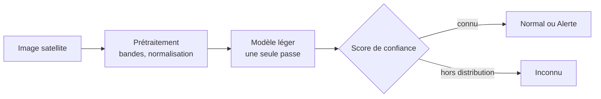

# Méthode

Le sujet demande de partir d'une approche simple, puis de l'améliorer pas à pas en mesurant l'effet de chaque choix.

## Pipeline

## Approches prévues

1. **Référence simple** : indice spectral de l'eau (NDWI) et seuil.
2. **Classifieur classique** sur des statistiques par bande.
3. **Réseau léger** (MobileNetV3, EfficientNet-B0 ou ResNet18), avec des poids pré-entraînés sur images satellites quand c'est possible.
4. **Détection de l'inconnu** : score calculé sur les sorties du réseau, seuil calibré sur la validation.
5. **Allègement** : export ONNX et quantification.

Les modèles pré-entraînés utilisés seront listés ici avec leur source et leur licence.
