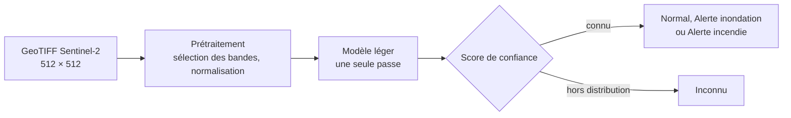

# Méthode

Le sujet demande de partir d'une approche simple, puis de l'améliorer pas à pas en mesurant l'effet de chaque choix.

## Pipeline

## Approches prévues

1. **Seuils NDWI + NBR** (`onelook.models.baselines`) : un pixel est « eau » si son NDWI dépasse un seuil, « brûlé » si son NBR passe sous un seuil sans être de l'eau ; la tuile est en alerte si la part de ces pixels dépasse une surface minimale. Les quatre réglages sont cherchés sur l'entraînement (F1 macro), sans regarder la validation ni le test.
2. **Classifieur sur statistiques** : 45 valeurs par tuile (moyenne, écart-type et centiles 10, 50, 90 de chaque bande et des indices NDWI, MNDWI, NBR), et un gradient boosting (scikit-learn) équilibré entre les classes.
3. **Réseau léger** (`onelook.models.cnn`) : MobileNetV3-Small pré-entraîné sur ImageNet, première couche adaptée à 6 bandes (les poids RVB vont sur B04, B03, B02, les bandes infrarouges reçoivent leur moyenne), image réduite à 256 × 256. Entraînement :
    - échantillonnage équilibré : chaque décision pèse autant, et parmi les normales, la Californie pèse autant que le reste du monde ;
    - rotations d'un quart de tour et miroirs, car une vue satellite n'a pas de « haut » ;
    - AdamW, taux d'apprentissage en une seule montée-descente (OneCycle), précision mixte, 15 époques ;
    - meilleure époque choisie sur le F1 macro de validation.

    Le modèle exporté contient sa normalisation et son redimensionnement : il prend une tuile brute 512 × 512 en réflectance.
4. **Détection de l'inconnu** (`onelook.ood.confidence`) : le modèle répond seulement si sa confiance (probabilité maximale) dépasse un seuil, calibré pour garder 95 % des bonnes réponses de validation. En dessous, la décision est Inconnu.
5. **Allègement** : export ONNX (inclus), puis quantification 8 bits.
6. **Petit VLM compressé** (piste ouverte par le mentor, `onelook.models.vlm`, `scripts/vlm.py`) : SmolVLM (256 ou 500 millions de paramètres) voit la tuile deux fois, en couleurs naturelles et en infrarouge court (384 × 384 px chacune), avec une question à trois réponses (A normal, B inondation, C incendie), et **rédige sa réponse** : la lettre, puis une phrase sur ce qu'il voit. Ses scores pour les trois lettres, lus juste après « Answer: », deviennent des probabilités traitées comme celles du réseau (même seuil « inconnu », mêmes mesures) ; la phrase est écrite ensuite, à partir de la lettre choisie, et ne peut donc pas la contredire. Testé tel quel, puis affiné par LoRA sur l'entraînement (mêmes tirages équilibrés que le réseau) : il apprend la lettre et une phrase modèle tirée des mesures de la tuile, par exemple « B. Flood: water covers about 25% of the tile on land that is usually dry. » Puis chargé en 4 bits. Il est comparé au réseau léger sur le point le plus difficile : distinguer l'eau habituelle de l'inondation.

Tous les entraînements tournent sur GPU distant (Google Colab), jamais en local.

## Ce qui sera mesuré à part

- **Fausses alertes sur l'eau permanente** : tuiles normales avec océan, fleuve, lac, réservoir ou rizières (48 en test). Voir [Eau permanente](data/water.md).
- **Fausses alertes hors Californie** : les normales sont à 76 % californiennes ; ce chiffre vérifie que le modèle n'a pas appris « Californie = feu ».
- **Rappel des inondations avec un intervalle** : 25 alertes seulement en test.

## Modèles pré-entraînés

| Modèle | Source | Licence |
|---|---|---|
| MobileNetV3-Small, ResNet18 (ImageNet) | torchvision | Code BSD-3-Clause ; licence des poids ImageNet à vérifier dans la documentation torchvision |
| SmolVLM-256M-Instruct, SmolVLM-500M-Instruct | Hugging Face (`HuggingFaceTB`) | Apache 2.0 |
