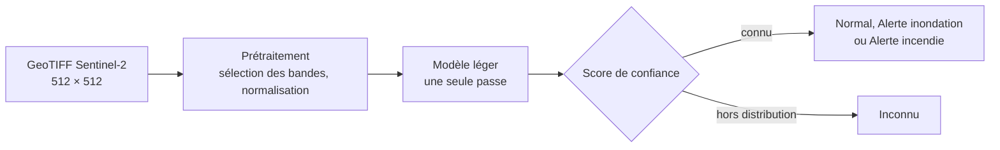

# Méthode

Le sujet demande de partir d'une approche simple, puis de l'améliorer pas à pas en mesurant l'effet de chaque choix.

## Pipeline

## Approches prévues

1. **Référence simple** : indices spectraux et seuils, NDWI pour l'eau, NBR pour le sol brûlé.
2. **Classifieur classique** sur des statistiques par bande.
3. **Réseau léger** à quatre décisions (MobileNetV3, EfficientNet-B0 ou ResNet18), avec des poids pré-entraînés sur images satellites quand c'est possible.
4. **Détection de l'inconnu** : score calculé sur les sorties du réseau, seuil calibré sur la validation.
5. **Allègement** : export ONNX et quantification.
6. **Petit VLM compressé** (piste ouverte par le mentor) : un modèle vision-langage de quelques centaines de millions de paramètres, testé d'abord tel quel, puis affiné (LoRA) sur l'entraînement, puis compressé (8 puis 4 bits). On lui fait choisir directement l'une des décisions, ce qui garde une seule passe, avec une courte justification en cas d'alerte. Il est comparé au réseau léger sur le point le plus difficile : distinguer l'eau habituelle de l'inondation.

Tous les entraînements tournent sur GPU distant (Google Colab), jamais en local.

## Ce qui sera mesuré à part

- **Fausses alertes sur l'eau permanente** : tuiles normales avec océan, fleuve, lac, réservoir ou rizières (48 en test). Voir [Eau permanente](data/water.md).
- **Fausses alertes hors Californie** : les normales sont à 76 % californiennes ; ce chiffre vérifie que le modèle n'a pas appris « Californie = feu ».
- **Rappel des inondations avec un intervalle** : 25 alertes seulement en test.

Les modèles pré-entraînés utilisés seront listés ici avec leur source et leur licence.
