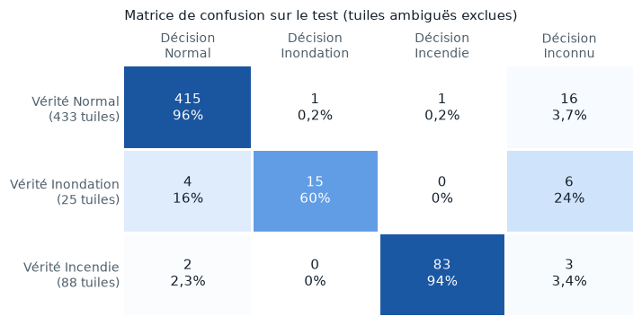
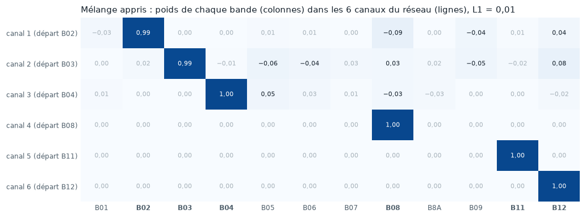
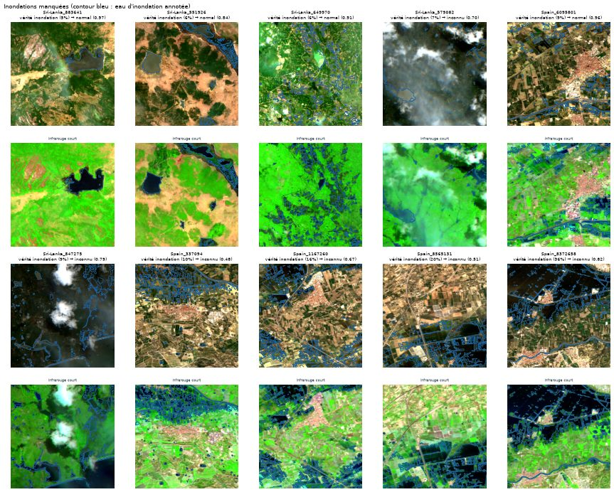
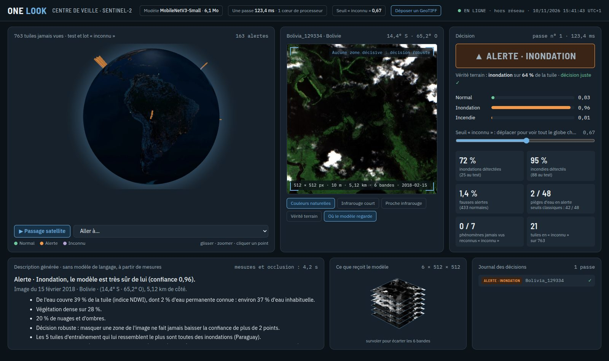

# Rapport final

*One Look · Piscine Intelligence Lab · Makers, 16 octobre → 16 novembre 2026 · Elfried KINZOUN · mentor : Lilian Rage*

Ce rapport fait la synthèse du projet. Chaque section renvoie à la page de la documentation qui détaille les chiffres, les figures et la méthode.

!!! abstract "En bref"
    Un modèle de **6,1 Mo** regarde une tuile Sentinel-2 de 512 × 512 pixels (environ 5 × 5 km) **une seule fois**, en **15 ms environ sur un cœur de processeur**, et répond Normal, Alerte · inondation, Alerte · incendie ou Inconnu.

    Sur des régions jamais vues à l'entraînement, il détecte **72 % des inondations** et **95 % des incendies**, pour **1,4 % de fausses alertes**. Des seuils classiques sur les indices d'eau et de brûlure en faisaient 22 %. Sur les 48 tuiles normales qui contiennent de l'eau (océans, fleuves, lacs, rizières), il ne lance que 2 fausses alertes, contre 42 pour les seuils.

    **Ce qui ne marche pas :** la réponse « inconnu », fondée sur la confiance du modèle, ne reconnaît pas les phénomènes jamais vus. Devant des coulées de lave ou des glissements de terrain, le modèle répond « normal ». Les petites inondations, entre 5 et 10 % de la tuile, restent le point faible.

## 1. Le problème

Un satellite d'observation produit plus d'images qu'il ne peut en envoyer au sol. Un modèle embarqué qui trie à bord, en signalant seulement ce qui mérite l'attention, fait gagner du temps de réaction et de la bande passante. Il doit pour cela être **petit, rapide, et surtout sobre en fausses alertes** : une alerte sur chaque rivière ou chaque champ labouré rendrait le tri inutile.

Le sujet impose une image en entrée, une passe et une décision, une mesure honnête sur des zones et des dates jamais vues, et une analyse des échecs.

## 2. Le cadrage

Décisions prises avec le mentor ([Cadrage](framing.md)) :

| Point | Décision | Raison |
|---|---|---|
| Satellite | Sentinel-2, optique | Données ouvertes, 10 m par pixel ; le radar Sentinel-1 était plus long à prendre en main |
| Format | GeoTIFF multibande, 512 × 512 | Format de l'évaluation, validé le 21 octobre |
| Anomalies | Inondations et zones brûlées récentes | Une seule suffisait ; deux phénomènes aux signatures différentes testent mieux le modèle |
| Seuil d'alerte | 5 % de la tuile touchée (environ 1,3 km²), normale sous 0,5 % | Entre les deux, la tuile est ambiguë et écartée de l'entraînement |
| Inconnu | Tout ce qui ne ressemble à rien de connu | Éruptions, glissements de terrain, marées noires : jamais utilisés à l'entraînement |

Les dégâts aux bâtiments (xBD) ont été écartés : ces images viennent d'un autre satellite, à 0,5 m par pixel, et un bâtiment tient dans un ou deux pixels Sentinel-2.

## 3. Les données : l'essentiel du travail

Le jeu final compte **3 312 tuiles** de 512 × 512 pixels à 10 m, en 12 bandes ([Carnet de données](data_card.md)). Quatre problèmes ont pris plus de temps que le modèle lui-même, et ont davantage compté pour le résultat.

**1. Deux sources, deux niveaux de traitement.** Les inondations (Sen1Floods11) sont en niveau L1C, au sommet de l'atmosphère ; les incendies (CaBuAr) sont en L2A, réflectance de surface. Mélangées telles quelles, elles auraient appris au modèle « L1C = inondation, L2A = incendie ». Toutes les tuiles, de toutes les classes, sont donc **relues en L2A depuis une seule source** (Microsoft Planetary Computer), aux mêmes lieux et aux mêmes dates ([Harmonisation](data/harmonisation.md)). Les tuiles CaBuAr n'ont pas de géoréférence : leur position a été retrouvée par corrélation avec des images basse résolution.

**2. Des normales qui ressemblent à des anomalies.** Un modèle qui n'a vu que des forêts et des champs prendrait chaque lac pour une inondation. Le catalogue des normales contient donc des **pièges** : océans, fleuves, réservoirs, rizières, neige, déserts, laves anciennes ([Images normales et pièges](data/normals.md)). L'eau permanente de chaque tuile est mesurée avec la carte JRC Global Surface Water, en accord à 90 % avec les annotations de Sen1Floods11 ([Eau permanente](data/water.md)).

**3. Un découpage sans fuite.** Deux tuiles voisines se ressemblent : réparties au hasard entre l'entraînement et le test, elles gonflent les scores. Le découpage se fait **par pays pour les inondations, et par zones de 10 km pour les incendies**. Aucune paire de tuiles de deux parties différentes n'est à moins de 10 km ([Étiquettes et découpage](data/labels_splits.md)). Le premier découpage des incendies, repris des plis de CaBuAr, fuyait : ces plis découpent une même région.

**4. Des étiquettes fausses.** L'analyse des erreurs du premier réseau a montré que la plupart de ses fausses alertes incendie étaient de **vraies cicatrices de feux plus anciens**, que CaBuAr n'annote pas. Croisées avec l'historique fédéral des périmètres de feux (NIFC), 317 normales californiennes recouvertes par un feu récent sont passées en ambiguës (étiquettes v3). **Sans rien changer au modèle, la précision incendie mesurée est passée de 81 à 97 %.**

| Partie | Normal | Inondation | Incendie | Ambiguë (écartée) |
|---|---|---|---|---|
| Entraînement | 1 194 | 88 | 286 | 443 |
| Validation | 366 | 15 | 66 | 107 |
| Test | 433 | 25 | 88 | 201 |

## 4. La méthode : du plus simple au réseau

Chaque étape est mesurée de la même façon : précision, rappel, fausses alertes, fausses alertes sur l'eau, taille et temps ([Méthode](method.md)).

1. **Seuils sur les indices** NDWI (eau) et NBR (brûlé), réglés sur l'entraînement.
2. **Classifieur sur statistiques** : 45 valeurs résumées par tuile et un *gradient boosting*.
3. **Réseau léger** : MobileNetV3-Small pré-entraîné sur ImageNet. Sa première couche est adaptée à 6 bandes (B02, B03, B04, B08, B11, B12), et il est entraîné sur Colab (GPU T4) avec un échantillonnage équilibré, des rotations et des miroirs, en 15 époques. Le modèle exporté en ONNX contient sa normalisation : il prend la tuile brute.
4. **Décision « inconnu »** : le réseau ne répond que si sa confiance dépasse un seuil calibré sur la validation.
5. **Allègement et variantes** : résolution 256 ou 512 px, quantification 8 bits, 12 bandes au lieu de 6.

## 5. Résultats

Test : 546 tuiles hors ambiguës, dans des régions absentes de l'entraînement ([Résultats](results.md)).

| Approche | Précision (inond. · incendie) | Rappel (inond. · incendie) | Fausses alertes | Fausses alertes sur l'eau | Taille | Temps |
|---|---|---|---|---|---|---|
| Seuils NDWI + NBR | 13 % · 89 % | 52 % · 81 % | 22 % | 88 % | – | – |
| Classifieur sur statistiques | 50 % · 84 % | 60 % · 65 % | 6,0 % | 31 % | 2,6 Mo | – |
| Réseau, 256 px | 81 % · 96 % | 68 % · 98 % | 1,8 % | 8,3 % | 6,1 Mo | 7 ms |
| **Réseau, 512 px (retenu)** | **86 % · 97 %** | **72 % · 95 %** | **1,4 %** | **4,2 %** | **6,1 Mo** | **15 ms** |
| Même réseau, poids int8 | 85 % · 98 % | 68 % · 94 % | 1,2 % | 4,2 % | 1,6 Mo | × 2,3 |
| Réseau à 12 bandes | 91 % · 97 % | 80 % · 97 % | 1,2 % | 2,1 % | 6,1 Mo | 29 ms |

Temps : médiane par tuile sur un cœur d'un Intel Core i7-10850H (ONNX Runtime). Les approches sans réseau ont été calculées en Python sur Colab, leurs temps ne sont pas comparables.

<figure markdown="span">
  
  <figcaption>Réseau de référence sur le test : sur 433 normales, 6 alertes à tort et 7 « inconnu ».</figcaption>
</figure>

Ce que montrent ces chiffres :

- **Le réseau voit « de l'eau inhabituelle », pas seulement « de l'eau ».** C'est le vrai progrès par rapport aux seuils, qui alertent sur 88 % des pièges d'eau.
- **La pleine résolution aide les petites zones**, pour le double du temps : on garde 512 px.
- **Le seuil « inconnu » règle le compromis.** Calibré sur la validation pour garder 98 % des bonnes réponses, il donne 1,4 % de fausses alertes. Un seuil strict descend à 0,5 % de fausses alertes, mais rate 3 inondations de plus.
- **Un seul entraînement par ligne** : sur 25 inondations, une tuile vaut 4 points de rappel. Les écarts de 2 ou 3 tuiles entre deux lignes ne sont pas significatifs.

### Trois hypothèses testées, trois réponses négatives utiles

| Hypothèse | Résultat | Décision |
|---|---|---|
| **Quantifier en int8** pour un modèle plus petit et plus rapide | L'int8 complet casse le réseau : il répond « normal » partout, à cause d'activations à très grande plage (de −160 à 120 pour un écart-type de 2,4). Les poids int8 seuls donnent 1,6 Mo et presque les mêmes décisions, mais pas plus vite sur ce processeur, qui n'a pas d'instructions int8 rapides | Modèle gardé en flottant ; piste : entraînement avec quantification simulée |
| **Toutes les bandes ne servent pas** | Brouiller n'importe laquelle des 6 bandes fait perdre des détections. B12 évite les fausses alertes (de 1,4 à 18 % sans elle). Surprise : sans le vert (B03), presque plus d'incendie détecté | Les 6 bandes sont gardées |
| **Donner les 12 bandes et laisser le modèle choisir** | Le mélange appris garde exactement les 6 bandes de départ. Les 12 bandes brutes font un peu mieux sur le test et moins bien sur la validation, pour un temps presque doublé | 6 bandes ([essai à 12 bandes](results.md#essai-a-12-bandes)) |

<figure markdown="span">
  
  <figcaption>Le mélange 1 × 1 appris sur les 12 bandes : chaque canal reste sur sa bande de départ.</figcaption>
</figure>

## 6. Analyse des échecs

Chaque erreur du test a été regardée image par image, en couleurs naturelles et en infrarouge court ([Limites et échecs](failure_cases.md)).

| Erreur (réseau de référence) | Nombre | Cause |
|---|---|---|
| Normale → alerte incendie | 3 sur 433 | Une tuile de désert et un lit de rivière sombre, dont la signature en infrarouge court ressemble à du brûlé |
| Normale → alerte inondation | 3 sur 433 | De l'eau saisonnière ou mouvante : rizières, estuaire, mares |
| Inondation manquée | 7 sur 25 | 6 couvrent 5 à 10 % de la tuile, juste au-dessus du seuil ; au Sri Lanka, des réservoirs pris pour de l'eau habituelle |
| Incendie manqué | 4 sur 88 | Petites zones au bord de la tuile ; périmètres qui englobent de la végétation intacte |

<figure markdown="span">
  
  <figcaption>Les 7 inondations manquées : de petites parts d'eau, souvent dans un paysage agricole.</figcaption>
</figure>

**Les phénomènes jamais vus.** Sur 16 événements réels lus en L2A, 7 montrent le phénomène de façon visible à 10 m : 4 éruptions et 3 glissements de terrain. Les 4 marées noires sont invisibles à cette résolution. Le réseau répond « normal » aux 7, avec une confiance de 0,70 à 0,97. C'est une limite connue des classifieurs : une forte confiance veut dire « loin des autres classes apprises », pas « proche de ce que j'ai vu ». La distance de Mahalanobis sur les descripteurs internes attrape 2 éruptions sur 4. Mais elle classerait aussi « atypiques » 13 des 25 inondations du test, ce qui révèle surtout le manque de variété des inondations d'entraînement.

Trois causes de fond ressortent de cette analyse :

1. **La définition de l'inondation est floue à la frontière.** Le jeu dit à la fois « rizière en eau = normal » (pièges) et « parcelles en eau au Sri Lanka = inondation » (Sen1Floods11). Le modèle hésite, ce qui est cohérent avec ses données.
2. **Les inondations manquent de variété** : 88 tuiles d'entraînement, venues de 6 pays.
3. **La confiance n'est pas une mesure de nouveauté.**

## 7. La démo : le Centre de veille

Une application locale, sans GPU ni réseau ([Démo](demo.md)) :

- un globe 3D où les 763 tuiles du test et du lot « inconnu » sont placées et colorées par la décision ;
- pour chaque tuile, la décision, les probabilités et le temps de la passe ;
- une carte « où le modèle regarde », obtenue par occlusion ;
- les tuiles d'entraînement les plus proches, et une **description en phrases générée à partir des mesures, sans modèle de langage**.

Un curseur recalcule en direct toutes les décisions selon le seuil « inconnu ». Un « passage satellite » enchaîne 8 cas choisis, réussites et échecs assumés compris. On peut déposer son propre GeoTIFF.

<figure markdown="span">
  
  <figcaption>Une inondation en Bolivie, détectée, avec sa description générée et ses plus proches voisins d'entraînement.</figcaption>
</figure>

La description explique aussi les échecs. Pour la coulée de lave de La Palma, déclarée normale, les plus proches voisins sont des laves anciennes de Lanzarote et d'Islande, étiquetées normales : pour le modèle, une lave fraîche ressemble à une lave ancienne.

## 8. Limites et suite

| Limite | Piste |
|---|---|
| « Inconnu » ne détecte pas les phénomènes nouveaux | Distance aux descripteurs d'entraînement, à mesurer sur un lot plus grand ; classe « autre » apprise sur des paysages variés |
| Petites inondations et eau saisonnière | Trancher la définition avec le mentor ; ajouter des inondations variées (WorldFloods, licence à vérifier) |
| Incendies tous californiens | Ajouter d'autres régions brûlées (Méditerranée, Australie) |
| Pas de gain de temps en int8 | Entraînement avec quantification simulée, sur un processeur doté d'instructions int8 |
| Niveau d'évaluation incertain | Si l'évaluation est en L1C, refaire la même chaîne avec une source L1C (Copernicus Data Space) |
| Un seul entraînement par configuration | Plusieurs graines, pour des intervalles d'incertitude |

**Non fait :** la piste du petit modèle vision-langage compressé, proposée par le mentor le 29 octobre pour raisonner sur l'emplacement des océans et des cours d'eau. La priorité est allée aux étiquettes, au réseau de référence et à la démo ; sa ligne reste vide dans le tableau.

## 9. Ce que j'en retiens

- **Les données ont plus pesé que le modèle.** L'harmonisation L1C/L2A, le découpage sans fuite et la correction des anciens feux ont changé les mesures bien plus que la résolution ou le nombre de bandes. Le gain le plus net du projet (précision incendie de 81 à 97 %) vient d'une correction d'étiquettes.
- **Regarder les erreurs une à une** a fait trouver les fausses étiquettes, la fuite du premier découpage et le trou de l'historique des feux après 2019.
- **Un résultat négatif mesuré est un résultat.** L'int8, les 12 bandes et la détection de l'inconnu par la confiance n'ont pas donné ce qu'on attendait ; chacun est documenté avec sa cause.
- **Dire ce qu'on ne sait pas** : 25 inondations en test, un seul entraînement par ligne. Les écarts de quelques tuiles ne prouvent rien.

## 10. Chronologie

| Dates | Étape |
|---|---|
| 16 → 22 oct | Mise en place, exploration ; format validé avec le mentor (21 oct) |
| 23 → 28 oct | Incendies ajoutés au périmètre ; harmonisation en L2A ; jeu complet ; découpage par région |
| 29 oct → 2 nov | Point d'étape (piste VLM) ; eau permanente JRC |
| 3 → 5 nov | Documentation illustrée ; approches simples ; premier réseau ; analyse des échecs |
| 6 → 9 nov | Anciens feux (étiquettes v2 puis v3) ; réseau à 512 px ; seuil « inconnu » ; quantification ; lot « inconnu » |
| 10 nov | Centre de veille ; importance des bandes ; préparation de l'essai à 12 bandes |
| 11 nov | Essai à 12 bandes ; rapport final |
| 16 nov | Présentation |

## Livrables

| Livrable | Où |
|---|---|
| Code | Dépôt GitHub `elfried96/onelook-alert_Elf` ; données et poids sur Hugging Face (non versionnés) |
| Carnet de données et licences | [Carnet de données](data_card.md) |
| Tableau comparatif | [Résultats](results.md) |
| Analyse des échecs | [Limites et échecs](failure_cases.md) |
| Démo sur des images jamais vues | [Démo](demo.md) |
| Reproduire chaque étape | [Reproduire](reproduce.md) |
