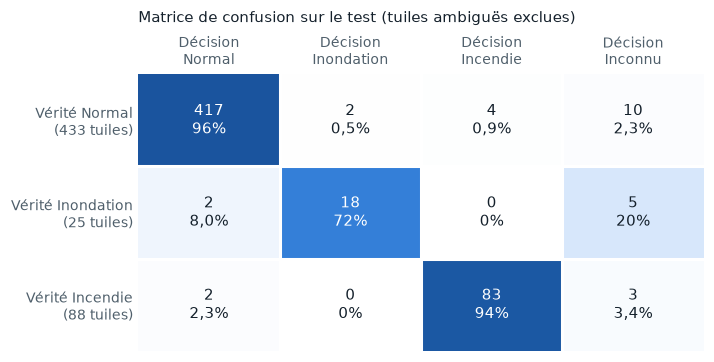

# Résultats

Tableau comparatif des approches testées, demandé par le sujet. Toutes les mesures sont faites sur le même **jeu de test** : 747 tuiles de zones jamais vues à l'entraînement, dont 546 hors tuiles ambiguës (433 normales, 25 inondations, 88 incendies). Les définitions sont dans `onelook.evaluation.metrics`.

!!! note "Étiquettes v3 (9 novembre)"
    Les réseaux sont mesurés avec les étiquettes v3 : les normales californiennes recouvertes par un feu de l'année de l'image ou de l'année précédente sont écartées (voir [anciens feux](data/labels_splits.md#anciens-feux-des-normales-qui-nen-sont-pas)). Ils ont été entraînés avant, sur les étiquettes v1 ou v2 : un réentraînement sur la v3 reste à faire. Entraînements sur Colab (`notebooks/03_colab_entrainement.ipynb`), temps mesurés en local. Quantification et piste VLM à venir.

| Approche | Précision (inond. · incendie) | Rappel (inond. · incendie) | Fausses alertes | Fausses alertes sur l'eau | Taille (Mo) | Temps (ms) |
|---|---|---|---|---|---|---|
| Seuils NDWI + NBR ⁴ | 13 % · 83 % | 52 % · 77 % | 24 % | 88 % | 0,00 | 17 ¹ |
| Classifieur sur statistiques ⁴ | 48 % · 82 % | 52 % · 63 % | 6,4 % | 27 % | 2,70 | 33 ¹ |
| MobileNetV3-Small, 256 px, entraîné en v1 | 84 % · 97 % | 64 % · 81 % | 1,2 % | 2,1 % | 6,10 | 7,6 ² |
| MobileNetV3-Small, 256 px, entraîné en v2 | 90 % · 84 % | 76 % · 97 % | 4,2 % | 8,3 % | 6,10 | 7,9 ² |
| **MobileNetV3-Small, 512 px, entraîné en v2** | **90 % · 95 %** | **72 % · 94 %** | **1,4 %** | **2,1 %** | **6,10** | **14,4 ²** |
| MobileNetV3-Small, ONNX quantifié | – | – | – | – | – | – |
| Petit VLM compressé | – | – | – | – | – | – |

Réseaux avec la décision « inconnu » (seuil de confiance calibré sur la validation). ¹ Calcul des indices et statistiques en Python (NumPy), sur Colab. ² ONNX Runtime, un cœur d'un Intel Core i7-10850H. ⁴ Mesuré sur le test v2 (522 tuiles) : les baselines seront remesurées avec le prochain passage sur Colab.

**Lecture rapide :**

- Les seuils voient « de l'eau », pas « de l'eau inhabituelle » : 88 % des pièges d'eau (océan, fleuve, lac, rizières) déclenchent une alerte inondation.
- Le classifieur sur statistiques réduit les fausses alertes (6 %), mais rate plus d'un incendie sur trois : une zone brûlée de 5 à 15 % de la tuile se noie dans des moyennes.
- **Le réseau à 512 px est le meilleur compromis.** Par rapport au premier réseau, il détecte 12 incendies de plus (94 % au lieu de 81 %) et 2 inondations de plus, pour un taux de fausses alertes presque identique (1,4 % au lieu de 1,2 %). Hors Californie, il ne se trompe que sur 1,8 % des normales, et sur une seule des 48 tuiles pièges d'eau (des rizières au Bangladesh).
- La pleine résolution coûte le double en temps (14 ms au lieu de 8), pour la même taille de modèle : seul le redimensionnement d'entrée change.
- **Le réseau à 256 px v2 montre la variance d'un entraînement.** Même architecture, mais une autre meilleure époque (9 au lieu de 13) et un seuil « inconnu » plus bas (0,70 au lieu de 0,84) : il alerte davantage (rappel incendie 97 %) et se trompe plus souvent (4,2 % de fausses alertes). Avec un seul entraînement par ligne, un écart de 1 à 2 points entre deux lignes n'est pas significatif.
- **La correction des étiquettes a changé la lecture des erreurs.** Sur le test v1, le premier réseau semblait faire 3,8 % de fausses alertes ; 15 des 17 fausses alertes incendie étaient en fait de vrais brûlés absents des étiquettes.

### Réseau à 512 px : matrice de confusion sur le test

Chaque ligne est une vérité, chaque colonne une décision du modèle. La diagonale compte les bonnes réponses ; hors diagonale, la ligne « Normal » donne les **faux positifs** (fausses alertes), et la colonne « Normal » les **faux négatifs** (anomalies manquées). La teinte suit la part de la ligne.

<figure markdown="span">
  
  <figcaption>Réseau à 512 px, étiquettes v3, 546 tuiles de test. Les erreurs sont détaillées tuile par tuile dans <a href="../failure_cases/">Limites et échecs</a>.</figcaption>
</figure>

| Vérité \ Décision | Normal | Alerte · inondation | Alerte · incendie | Inconnu |
|---|---|---|---|---|
| Normal (433) | 417 | 2 | 4 | 10 |
| Alerte · inondation (25) | 2 | 18 | 0 | 5 |
| Alerte · incendie (88) | 2 | 0 | 83 | 3 |

Sans la décision « inconnu » (on garde toujours la classe la plus probable), le même réseau atteint 88 % de rappel inondation et 97 % de rappel incendie, pour 1,8 % de fausses alertes. « Inconnu » ne concerne que 3 % des tuiles.

### Courbes d'entraînement

15 époques pour chaque réseau, environ 48 s chacune sur un T4, à 256 comme à 512 px (la lecture des tuiles domine). À 512 px, le F1 macro de validation atteint 0,91 (époque 14, retenue). En validation, le rappel des inondations atteint 100 % (sur 15 tuiles), mais celui des incendies plafonne autour de 70 %, bien en dessous du test (94 %) : les zones brûlées de validation sont plus petites ou plus difficiles, et la validation ne compte que 66 incendies.

## Comment lire le tableau

| Colonne | Définition |
|---|---|
| Précision | Parmi les alertes levées, la part qui est juste |
| Rappel | Parmi les vraies anomalies, la part détectée. Une réponse « inconnu » compte comme manquée |
| Fausses alertes | Part des tuiles normales qui déclenchent une alerte |
| Fausses alertes sur l'eau | Idem, sur les 48 normales avec océan, fleuve, lac, réservoir ou rizières |
| Taille | Fichier du modèle (ONNX, ou seuils et classifieur pour les baselines) |
| Temps | Médiane par tuile 512 × 512, sur un seul cœur de processeur : l'approximation la plus proche d'un calculateur embarqué |

Mesures complémentaires, dans les fichiers `runs/<nom>/eval_test_*.json` : F1 macro, part d'« inconnu », fausses alertes hors Californie. Les runs v1 et v2 sont rangés dans le dépôt privé `Elfried9684/onelook-alert-runs`.

**Incertitude :** avec 25 inondations en test, une seule tuile manquée fait varier le rappel de 4 points.

## Matériel

- Entraînement : Google Colab, GPU NVIDIA T4.
- Temps d'inférence : un cœur de processeur, ONNX Runtime ; la machine de mesure est indiquée avec chaque résultat.
