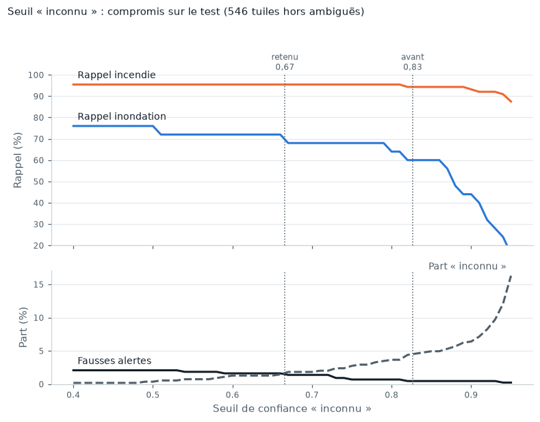
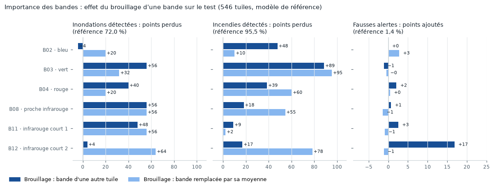

# Résultats

Tableau comparatif des approches testées, demandé par le sujet. Toutes les mesures sont faites sur le même **jeu de test** : 747 tuiles de zones jamais vues à l'entraînement, dont 546 hors tuiles ambiguës (433 normales, 25 inondations, 88 incendies). Les définitions sont dans `onelook.evaluation.metrics`.

!!! note "Étiquettes v3 (9 novembre)"
    Toutes les lignes sont mesurées avec les étiquettes v3 : les normales californiennes recouvertes par un feu de l'année de l'image ou de l'année précédente sont écartées (voir [anciens feux](data/labels_splits.md#anciens-feux-des-normales-qui-nen-sont-pas)). Les lignes « entraîné en v1 / v2 » sont d'anciens réseaux, entraînés sur des étiquettes moins propres et gardés pour comparaison. Entraînements sur Colab (`notebooks/03_colab_entrainement.ipynb`), temps mesurés en local. Piste VLM : zéro-shot fait, affinage en cours (`notebooks/06_kaggle_vlm.ipynb`).

| Approche | Précision (inond. · incendie) | Rappel (inond. · incendie) | Fausses alertes | Fausses alertes sur l'eau | Taille (Mo) | Temps (ms) |
|---|---|---|---|---|---|---|
| Seuils NDWI + NBR | 13 % · 89 % | 52 % · 81 % | 22 % | 88 % | 0,00 | 17 ¹ |
| Classifieur sur statistiques | 50 % · 84 % | 60 % · 65 % | 6,0 % | 31 % | 2,59 | 34 ¹ |
| MobileNetV3-Small, 256 px, entraîné en v1 ³ | 84 % · 97 % | 64 % · 81 % | 1,2 % | 2,1 % | 6,10 | 7,6 ² |
| MobileNetV3-Small, 256 px, entraîné en v2 ³ | 90 % · 84 % | 76 % · 97 % | 4,2 % | 8,3 % | 6,10 | 6,9 ² |
| MobileNetV3-Small, 512 px, entraîné en v2 ³ | 90 % · 95 % | 72 % · 94 % | 1,4 % | 2,1 % | 6,10 | 15,4 ² |
| MobileNetV3-Small, 256 px, entraîné en v3 | 81 % · 96 % | 68 % · 98 % | 1,8 % | 8,3 % | 6,10 | 6,8 ² |
| **MobileNetV3-Small, 512 px, entraîné en v3** | **86 % · 97 %** | **72 % · 95 %** | **1,4 %** | **4,2 %** | **6,10** | **14,7 ²** |
| Même réseau, seuil « inconnu » strict (0,83) ³ | 94 % · 99 % | 60 % · 94 % | 0,5 % | 0 % | 6,10 | 14,7 ² |
| Même réseau, poids int8 seuls ⁵ | 85 % · 98 % | 68 % · 94 % | 1,2 % | 4,2 % | 1,64 | × 2,3 ⁵ |
| Même réseau, int8 complet ⁵ | – · – | 0 % · 0 % | 0 % | 0 % | 1,88 | × 1,4 ⁵ |
| 12 bandes L2A dans la première convolution ⁶ | 91 % · 97 % | 80 % · 97 % | 1,2 % | 2,1 % | 6,10 | 28,6 ⁶ |
| 12 bandes, mélange 1 × 1 appris + L1 ⁶ | 88 % · 97 % | 60 % · 94 % | 1,2 % | 2,1 % | 6,10 | 32,4 ⁶ |
| Petit VLM SmolVLM-256M, sans affinage ⁷ | – · 17 % | 0 % · 98 % | 92 % | 85 % | 513 | 7 400 ⁷ |
| Petit VLM SmolVLM-500M, sans affinage ⁷ | – · 16 % | 0 % · 100 % | 99 % | 100 % | 1 015 | – |

Réseaux avec la décision « inconnu » (seuil de confiance calibré sur la validation, voir [plus bas](#le-seuil-inconnu)). ¹ Calcul des indices et statistiques en Python (NumPy), sur Colab. ² ONNX Runtime, un cœur d'un Intel Core i7-10850H ; les cinq derniers réseaux ont été chronométrés ensemble, en alternance, pour être comparables. ³ Seuil calibré en gardant 95 % des bonnes réponses de validation ; les autres réseaux gardent 98 %. ⁵ Quantification après entraînement, voir [plus bas](#quantification) ; temps donné par rapport au flottant mesuré dans la même séance. ⁶ Essai à 12 bandes, voir [plus bas](#essai-a-12-bandes) ; chronométré en alternance avec le réseau de référence, qui prenait 15,3 ms dans la même séance. ⁷ VLM tel quel (zéro-shot), voir [plus bas](#piste-vlm) ; taille des poids en mémoire sur GPU (16 bits) ; temps de la seule décision en PyTorch float32, un cœur, mesuré sur 1 tuile en local.

**Lecture rapide :**

- Les seuils voient « de l'eau », pas « de l'eau inhabituelle » : 88 % des pièges d'eau (océan, fleuve, lac, rizières) déclenchent une alerte inondation.
- Le classifieur sur statistiques réduit les fausses alertes (6 %), mais rate plus d'un incendie sur trois : une zone brûlée de 5 à 15 % de la tuile se noie dans des moyennes.
- **Le réseau à 512 px entraîné en v3 est le modèle de référence.** Sur le test, il détecte 72 % des inondations et 95 % des incendies, pour 1,4 % de fausses alertes (6 normales sur 433). C'est presque exactement le 512 px v2 : réentraîner sur les étiquettes propres change peu le test. L'apport de la v3 est surtout une mesure plus juste (les fausses alertes du v2 étaient en partie de vrais brûlés) et un seuil calibré sur une validation propre.
- **Le seuil « inconnu » règle le compromis.** Avec le seuil strict (0,83), le même réseau ne fait que 2 fausses alertes, mais rate 3 inondations et 1 incendie de plus. Le seuil retenu (0,67) est choisi sur la validation seule ; le test confirme ensuite le compromis.
- Le 256 px v3 a un rappel incendie un peu meilleur (98 %), mais plus de fausses alertes (1,8 %), dont 4 sur 48 pièges d'eau. La pleine résolution aide surtout les petites zones, pour le double du temps (15 ms au lieu de 7) et la même taille de modèle.
- **Un seul entraînement par ligne** : un écart de 1 à 2 points, ou de 2 à 3 inondations, entre deux lignes n'est pas significatif. Le 256 px v2 l'a montré (une autre meilleure époque, un autre seuil, un autre compromis).

### Le seuil « inconnu »

Le réseau répond « inconnu » quand sa confiance (la plus haute probabilité) est sous un seuil. Ce seuil est calibré sur la validation : on garde une part fixe des tuiles que le réseau classe correctement, les moins sûres passent en « inconnu » (`onelook.ood.confidence`).

Avec 95 % gardées, le seuil du 512 px v3 montait à 0,83 et envoyait **18 des 66 incendies de validation** en « inconnu ». Balayage sur la validation (`scripts/calibrate.py`) :

| Part gardée | Seuil | Rappel inondation | Rappel incendie | Fausses alertes | « Inconnu » |
|---|---|---|---|---|---|
| 95 % (avant) | 0,83 | 87 % | 67 % | 0,3 % | 6,7 % |
| 97 % | 0,73 | 87 % | 77 % | 0,3 % | 4,3 % |
| **98 % (retenu)** | **0,67** | **87 %** | **79 %** | **0,5 %** | **3,1 %** |
| 99 % | 0,59 | 87 % | 82 % | 0,8 % | 1,3 % |

Règle de choix : la part la plus haute dont les fausses alertes de validation restent à 0,5 % au plus. La validation ne compte que 15 inondations, toutes au-dessus de ces seuils : elle ne dit rien du rappel inondation, qui ne se lit que sur le test.

<figure markdown="span">
  
  <figcaption>Le même balayage sur le test, pour information (le seuil n'y est pas choisi). Baisser le seuil récupère des inondations, au prix de quelques fausses alertes ; au-delà de 0,85, « inconnu » avale les vraies anomalies.</figcaption>
</figure>

Deux limites à garder en tête :

- **Le seuil retenu tombe sur une marche.** Une inondation du test (Espagne, 16 % de la tuile) a une confiance de 0,667, juste au-dessus du seuil (0,666). Un seuil de 0,67 l'aurait manquée : sur 25 inondations, le rappel bouge par paliers de 4 points.
- **Un seuil plus bas laisse moins de place à « inconnu »** pour les phénomènes jamais vus (éruptions, glissements, marées noires). Le lot dédié dira si 0,67 les attrape encore ; sinon, il faudra un autre signal que la seule confiance.

### Réseau de référence (512 px, v3) : matrice de confusion sur le test

Chaque ligne est une vérité, chaque colonne une décision du modèle. La diagonale compte les bonnes réponses ; hors diagonale, la ligne « Normal » donne les **faux positifs** (fausses alertes), et la colonne « Normal » les **faux négatifs** (anomalies manquées). La teinte suit la part de la ligne.

<figure markdown="span">
  
  <figcaption>Réseau à 512 px entraîné en v3, seuil « inconnu » 0,67, 546 tuiles de test. Les erreurs sont détaillées tuile par tuile dans <a href="../failure_cases/">Limites et échecs</a>.</figcaption>
</figure>

| Vérité \ Décision | Normal | Alerte · inondation | Alerte · incendie | Inconnu |
|---|---|---|---|---|
| Normal (433) | 420 | 3 | 3 | 7 |
| Alerte · inondation (25) | 5 | 18 | 0 | 2 |
| Alerte · incendie (88) | 4 | 0 | 84 | 0 |

Avec le seuil strict (0,83) : 415 / 1 / 1 / 16 sur les normales, 4 / 15 / 0 / 6 sur les inondations, 2 / 0 / 83 / 3 sur les incendies. Sans « inconnu » (on garde toujours la classe la plus probable) : 76 % de rappel inondation, 95 % de rappel incendie, 2,3 % de fausses alertes.

### Quantification

But : un modèle plus petit et plus rapide pour un calculateur embarqué, sans réentraîner (`scripts/quantize.py`, quantification après entraînement d'ONNX Runtime). Trois variantes du réseau de référence (512 px, v3, seuil 0,67), toutes avec des poids int8 par canal :

| Variante | Rappel (inond. · incendie) | Fausses alertes | Taille (Mo) | Temps par rapport au flottant |
|---|---|---|---|---|
| Flottant 32 bits (référence) | 72 % · 95 % | 1,4 % | 6,10 | × 1 |
| Int8 complet (poids et activations) | 0 % · 0 % | 0 % | 1,88 | × 1,4 (plus lent) |
| Poids int8, activations 16 bits | 72 % · 94 % | 1,2 % | 1,88 | × 3,2 |
| Poids int8 seuls, calcul en flottant | 68 % · 94 % | 1,2 % | 1,64 | × 2,3 |

Temps mesurés ensemble, en alternance, sur un cœur de l'i7-10850H : la machine étant plus ou moins chargée selon les séances, seul le rapport au flottant de la même séance est comparable (deux séances : × 1,4 / 3,2 à 3,3 / 2,3 à 2,5).

**L'int8 complet ne marche pas sur ce réseau** : il répond « normal » sur toutes les tuiles. Le diagnostic, couche par couche :

- La perte vient des **activations**, pas des poids : quantifiés seuls, les poids ne s'écartent en moyenne que de 2 % au plus de leur valeur, couche par couche, et le réseau garde ses décisions.
- La première convolution sort des valeurs de -160 à 120 pour un écart-type de 2,4, à cause de pixels très brillants (jusqu'à 13 écarts-types après normalisation). Sur 8 bits, un pas vaut alors 0,45 écart-type : les détails utiles disparaissent. D'autres couches (blocs à excitation, *hard-swish*) ont le même profil.
- Couper les extrêmes (calibrage par centile 99,9 ou 99,99), garder la première couche en flottant ou réduire la plage des poids n'y change presque rien : la moitié des décisions restent fausses sur un échantillon de validation.

**L'int8 n'accélère pas non plus le calcul ici** : ce processeur n'a pas les instructions int8 rapides (VNNI), et MobileNetV3-Small est surtout fait de convolutions par canal, peu coûteuses en flottant. Les deux variantes qui gardent les décisions sont plus lentes, car elles reconvertissent poids ou activations à chaque passe.

**Bilan :** la quantification après entraînement divise la taille du fichier par 3,7 (poids int8 seuls, 1,6 Mo) pour une décision quasi identique (1 inondation de moins sur 25), mais elle ne fait pas gagner de temps sur ce processeur. Le modèle de référence reste en flottant. Deux pistes, non faites :

- **Entraînement avec quantification simulée** (*quantization-aware training*, sur Colab) : le réseau apprend à tolérer les activations 8 bits. C'est la méthode usuelle pour MobileNetV3.
- **Mesurer sur le matériel visé** : un processeur ARM avec instructions int8, ou un accélérateur, peut tirer de l'int8 un vrai gain de temps qu'un i7 de 2020 ne montre pas.

### Phénomènes jamais vus

Sur les 7 tuiles du lot « inconnu » où le phénomène se voit (4 éruptions, 3 glissements de terrain), le réseau de référence répond « normal » 7 fois, avec une confiance de 0,70 à 0,97 ; le réseau à 256 px répond « inconnu » 2 fois. Aucune fausse alerte, mais la décision « inconnu » fondée sur la confiance ne détecte pas les phénomènes nouveaux. Détail, images et piste d'un autre signal dans [Limites et échecs](failure_cases.md#phenomenes-jamais-vus-le-lot-inconnu).

### Importance des bandes

Le modèle reçoit 6 bandes. Lesquelles comptent ? Sans réentraîner (`scripts/band_importance.py`), on brouille une bande à la fois sur toutes les tuiles et on mesure ce que le modèle perd. Deux façons de brouiller : prendre la même bande d'une autre tuile tirée au hasard (permutation), ou la remplacer par sa valeur moyenne d'entraînement (l'information disparaît).

<figure markdown="span">
  
  <figcaption>Points perdus en détection, ou ajoutés en fausses alertes, quand on brouille une bande. Modèle de référence, test (546 tuiles hors ambiguës), seuil « inconnu » 0,67.</figcaption>
</figure>

| Bande brouillée | Test : inondations · incendies · fausses alertes (permutation / moyenne) | Validation : idem |
|---|---|---|
| Aucune (référence) | 72 · 95 · 1,4 % | 87 · 79 · 0,5 % |
| B02 · bleu | 76 · 48 · 1,4 % / 52 · 85 · 4,2 % | 67 · 8 · 0,3 % / 73 · 47 · 3,5 % |
| B03 · vert | 16 · 7 · 0,2 % / 40 · 0 · 0,9 % | 47 · 0 · 0,5 % / 60 · 0 · 0 % |
| B04 · rouge | 32 · 57 · 3,5 % / 52 · 35 · 1,8 % | 40 · 18 · 2,2 % / 67 · 29 · 1,1 % |
| B08 · proche infrarouge | 16 · 77 · 2,1 % / 16 · 41 · 0 % | 53 · 44 · 2,2 % / 53 · 26 · 0 % |
| B11 · infrarouge court 1 | 24 · 86 · 3,9 % / 16 · 93 · 0,5 % | 47 · 55 · 6,3 % / 40 · 64 · 0,8 % |
| B12 · infrarouge court 2 | 68 · 78 · 18,2 % / 8 · 17 · 0,2 % | 47 · 67 · 13,7 % / 67 · 18 · 1,1 % |

Ce qui tient sur le test comme sur la validation, avec les deux méthodes :

- **Aucune bande n'est inutile.** Brouiller n'importe laquelle fait perdre au moins une des deux détections, souvent beaucoup. Le réseau ne lit pas une bande isolée : il combine les six.
- **Les inondations dépendent le plus du vert, du proche infrarouge et de l'infrarouge court 1** (B03, B08, B11), les bandes des indices d'eau NDWI et MNDWI : brouillée, chacune fait tomber le rappel inondation entre 16 et 60 %, dans tous les cas mesurés.
- **L'infrarouge court 2 (B12) évite les fausses alertes.** Remplacé par celui d'une autre tuile, il fait passer les fausses alertes de 1,4 à 18 % sur le test (de 0,5 à 14 % en validation) : avec un B12 incohérent, des tuiles normales prennent la signature d'un sol brûlé. C'est la bande de l'indice de brûlure NBR.
- **Surprise : sans le vert (B03), le modèle ne détecte presque plus aucun incendie** (0 à 7 %, sur les deux parties et avec les deux méthodes). La physique ne l'annonce pas, les indices de brûlure reposant sur le proche infrarouge et l'infrarouge court. Le réseau semble s'en servir comme référence de luminosité visible ; la mesure dit qu'il en dépend, pas pourquoi.

**Limite de la méthode :** une bande brouillée donne une image que le modèle n'a jamais vue, aux relations entre bandes incohérentes. La mesure dit de quoi ce modèle-ci dépend, pas ce dont un modèle aurait besoin : les bandes sont corrélées, un réseau entraîné sans l'une d'elles pourrait s'en passer. Seul un réentraînement le dirait ; c'est l'objet de l'[essai à 12 bandes](#essai-a-12-bandes).

### Essai à 12 bandes

Hypothèse : donner au réseau les 12 bandes L2A (B10 n'existe pas en L2A) et le laisser choisir celles qui l'aident, au lieu des 6 bandes retenues à la main. Deux réseaux, entraînés comme le réseau de référence (512 px, étiquettes v3, 15 époques, même découpage, seuil « inconnu » qui garde 98 % des bonnes réponses de validation), sur le paquet `data/pack12/` :

- **12 bandes brutes** : la première convolution reçoit les 12 bandes (poids RVB pré-entraînés sur B04, B03, B02, leur moyenne pour les autres) ;
- **mélange appris** : une convolution 1 × 1 (`BandMixer`) combine les 12 bandes en 6 canaux avant le réseau, avec une pénalité L1 (0,01) qui pousse chaque canal à n'utiliser que peu de bandes. Ses poids sont normalisés ligne par ligne : sinon la BatchNorm qui suit compense et la L1 rétrécit tout sans rien choisir. Au départ, chaque canal recopie une des 6 bandes de référence.

| Réseau | Test : rappel (inond. · incendie) · fausses alertes · eau | Validation : idem | F1 val. (époque 15) | Temps (ms) |
|---|---|---|---|---|
| 6 bandes (référence) | 72 % · 95 % · 1,4 % · 2 sur 48 | 87 % · 79 % · 0,5 % · 0 | 0,94 | 15,3 |
| 12 bandes brutes | 80 % · 97 % · 1,2 % · 1 sur 48 | 80 % · 62 % · 0,8 % · 0 | 0,90 | 28,6 |
| 12 bandes, mélange + L1 | 60 % · 94 % · 1,2 % · 1 sur 48 | 93 % · 70 % · 0,8 % · 0 | 0,92 | 32,4 |

<figure markdown="span">
  
  <figcaption>Poids du mélange après 15 époques. Les 6 canaux gardent leur bande de départ (poids 0,99 à 1,00) ; les 6 bandes ajoutées (B01, B05, B06, B07, B8A, B09) pèsent au plus 0,06 dans un canal.</figcaption>
</figure>

Ce qu'on en retient :

- **Le mélange n'a pris aucune bande nouvelle.** Les trois canaux infrarouges (B08, B11, B12) sont restés exactement sur leur bande ; seuls les canaux visibles empruntent un peu ailleurs (au plus 0,09, B08 retiré du bleu, B12 ajouté au vert). Les bandes « red edge » (B05, B06, B07, B8A), l'aérosol (B01) et la vapeur d'eau (B09) n'apportent rien que le réseau sache utiliser. **Limite** : le mélange partait des 6 bandes de référence et la L1 pénalise tout écart ; le résultat dit qu'aucune bande ajoutée ne valait sa pénalité, pas qu'un départ neutre aurait trouvé la même chose.
- **Les 12 bandes brutes ne gagnent pas nettement.** Sur le test, 2 inondations et 1 incendie de plus sont détectés et une fausse alerte de moins ; sur la validation, c'est l'inverse, avec 11 incendies de moins (62 % au lieu de 79 %) et un F1 de 0,90 au lieu de 0,94. Un seul entraînement par ligne : ces écarts de quelques tuiles, de sens contraire d'une partie à l'autre, ne sont pas significatifs.
- **Le coût est net** : le temps par tuile double presque (28,6 ms au lieu de 15,3), et une tuile à 12 bandes pèse deux fois plus à lire et à transmettre. Le mélange coûte un peu plus (32,4 ms), car l'export garde la convolution 1 × 1 à part ; fondu dans la première convolution (deux opérations linéaires), il reviendrait au coût du réseau à 12 bandes brutes, pas à celui du réseau à 6 bandes.
- **Conclusion : on garde les 6 bandes.** C'est cohérent avec la [mesure par brouillage](#importance-des-bandes) : chacune des 6 bandes compte, et les bandes ajoutées n'apportent pas d'information que le réseau exploite. Figure : `scripts/band_mixer.py`.

### Piste VLM

Hypothèse du mentor (29 octobre) : un petit modèle vision-langage, qui « connaît » le monde, distinguerait mieux l'eau habituelle (mer, fleuves, rizières) d'une inondation. SmolVLM (256M et 500M, Apache 2.0) voit la tuile deux fois (couleurs naturelles, infrarouge court), choisit une lettre (A normal, B inondation, C incendie) puis rédige une phrase. Les scores des trois lettres deviennent des probabilités, traitées comme celles du réseau : même seuil « inconnu », mêmes mesures (`onelook.models.vlm`, `scripts/vlm.py`).

**Sans affinage (zéro-shot, Colab, 12 novembre), le VLM répond « incendie » à presque tout.**

| Modèle | Test : rappel (inond. · incendie) · fausses alertes · eau | Validation : idem |
|---|---|---|
| SmolVLM-256M | 0 % · 98 % · 92 % · 85 % | 0 % · 97 % · 92 % · 79 % |
| SmolVLM-500M | 0 % · 100 % · 99 % · 100 % | 0 % · 97 % · 98 % · 100 % |

- Aucune inondation n'est reconnue, et 397 normales sur 433 deviennent des « incendies » (256M). Le rappel incendie de 98 % n'est donc pas une détection : la lettre C sort quelle que soit l'image.
- Le plus gros modèle fait pire (99 % de fausses alertes) : la taille n'apporte rien tant que le modèle ne sait pas lire une image Sentinel-2. Ses connaissances viennent de photos ordinaires, pas de vues satellite en fausses couleurs.
- Le coût est sans commune mesure : 513 Mo et 7,4 s par tuile sur un cœur (256M, float32), contre 6,1 Mo et 15 ms pour le réseau de référence, soit environ 500 fois plus lent.

**Affinage LoRA** (le modèle apprend la lettre et une phrase modèle tirée des mesures de chaque tuile) : un premier passage sur Colab a dépassé la mémoire du T4, puis Colab gratuit a coupé l'accès au GPU. Il est relancé sur Kaggle (`notebooks/06_kaggle_vlm.ipynb`) ; ses résultats viendront ici.

### Courbes d'entraînement

15 époques pour chaque réseau, environ 52 s chacune sur un T4, à 256 comme à 512 px (la lecture des tuiles domine). À 512 px, le F1 macro de validation atteint 0,94 (époque 14, retenue), contre 0,92 à 256 px (époque 13). En validation, le rappel des inondations atteint 87 % (13 sur 15) et celui des incendies 88 %, contre environ 70 % avec les étiquettes v2 : les normales recouvertes par un ancien feu brouillaient aussi la validation.

## Comment lire le tableau

| Colonne | Définition |
|---|---|
| Précision | Parmi les alertes levées, la part qui est juste |
| Rappel | Parmi les vraies anomalies, la part détectée. Une réponse « inconnu » compte comme manquée |
| Fausses alertes | Part des tuiles normales qui déclenchent une alerte |
| Fausses alertes sur l'eau | Idem, sur les 48 normales avec océan, fleuve, lac, réservoir ou rizières |
| Taille | Fichier du modèle (ONNX, ou seuils et classifieur pour les baselines) |
| Temps | Médiane par tuile 512 × 512, sur un seul cœur de processeur : l'approximation la plus proche d'un calculateur embarqué |

Mesures complémentaires, dans les fichiers `runs/<nom>/eval_test_*.json` : F1 macro, part d'« inconnu », fausses alertes hors Californie. Les runs v1, v2 et v3 sont rangés dans le dépôt privé `Elfried9684/onelook-alert-runs`.

**Incertitude :** avec 25 inondations en test, une seule tuile manquée fait varier le rappel de 4 points.

## Matériel

- Entraînement : Google Colab, GPU NVIDIA T4.
- Temps d'inférence : un cœur de processeur, ONNX Runtime ; la machine de mesure est indiquée avec chaque résultat.
